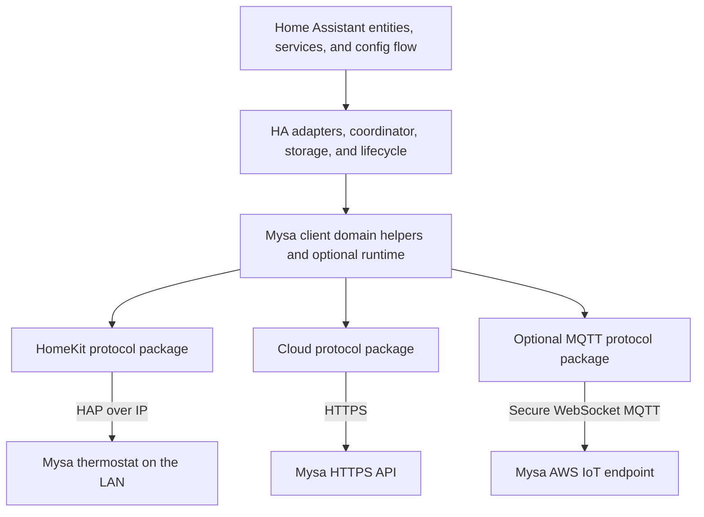

# Integration architecture

Mysa Local is one Home Assistant integration with three independent device
protocols. HomeKit is the preferred path for thermostat readings and control on
the LAN. HTTPS provides cloud settings, account features and fallback control;
MQTT adds live, read-only telemetry when account access is enabled.

The protocol packages do not call each other. The client domain helpers and
optional runtime compose semantic operations over caller-supplied state and
transports. Home Assistant chooses when to run that work and adapts its results
to entities and services.

## Protocol implementations

The [`mysa-client` package](https://github.com/SokolskyNikita/mysa-client)
implements the cloud API, HomeKit over IP, and an optional MQTT client. It owns
Cognito authentication, HTTP requests, response parsing and command encoding,
HomeKit characteristic parsing, MQTT connection and message parsing, and
protocol errors. Its cloud-domain helpers also own reusable Mysa validation,
device interpretation, cross-source state reconciliation,
command-confirmation evidence, and schedule/hold/account workflows. Optional
runtime helpers compose caller-supplied state and transports for command
routing and telemetry freshness. These APIs have no Home Assistant dependency.
They act only when called: they do not poll, persist data, or launch tasks.

MQTT stays opt-in for standalone consumers; Mysa Local explicitly opts in when
Mysa account access and cloud use are enabled, its global **Live MQTT readings**
option is on, and each selected thermostat's MQTT setting is on. The integration
passes the client only the enabled account-device allowlist. See the package's
[cloud guide](https://github.com/SokolskyNikita/mysa-client/blob/main/src/mysa_client/cloud/README.md),
[HomeKit guide](https://github.com/SokolskyNikita/mysa-client/blob/main/src/mysa_client/homekit/README.md),
[runtime guide](https://github.com/SokolskyNikita/mysa-client/blob/main/docs/runtime.md),
and [MQTT guide](https://github.com/SokolskyNikita/mysa-client/blob/main/docs/mqtt.md)
for public APIs, lifecycle, timeouts, and failure handling. The [HA MQTT guide](mqtt.md)
covers integration options, entity value selection, and hardware evidence.

Home Assistant installs the library as an external dependency. The integration
adapters own the caller-provided HTTP session and discovery/controller
lifecycle, durable token, pairing, and schedule-journal storage, polling
cadence, task scheduling, freshness choices, and user-facing errors. Client
helpers supply Mysa-specific interpretation and workflow correctness using
those explicit inputs. Protocol imports use `mysa_client.cloud`,
`mysa_client.homekit`, and `mysa_client.mqtt`, plus documented domain/runtime
modules as needed. Boundary checks verify package independence and HA's use of
the supported helpers.

## Home Assistant integration layer

The integration layer owns lifecycle, policy, persistence, and presentation:

- `homekit_adapter.py` connects Home Assistant discovery, controller, and
  pairing lifecycle to the HomeKit protocol package.
- `local_adapter.py` adapts the HomeKit device to Home Assistant polling,
  subscriptions, availability, and shutdown.
- `cloud_coordinator.py` schedules cloud refreshes and retries. It delegates
  Mysa field reconciliation, command construction/validation, and pending
  confirmation to client helpers, then adapts typed state to HA.
- The account runtime owns one MQTT session for account thermostats selected by
  the global and per-thermostat options. It delegates field filtering,
  receipt-time freshness, quiet-stream requests, and renewal deadlines to the
  client's telemetry helpers; HA owns session lifecycle, reconnects, task
  scheduling, and option changes. See the [MQTT guide](mqtt.md).
- `thermostat.py` adapts the client `DeviceView` to HA climate attributes and
  entity state, while supplying current local/cloud/MQTT values and freshness
  policy.
- `command_router.py` adapts HA's local session and cloud callbacks to the
  client's optional `CommandRouter`. The runtime serializes writes and
  reconciles late local outcomes; HA owns adapter lifecycle and error wording.
- `pairing_store.py` persists pairing credentials and recovery state using HA
  storage. The HomeKit pairing flow receives pairing data and calls the HA
  persistence callback as soon as the accessory accepts a pairing, before any
  further network read.
- `config_flow.py` owns initial setup and HomeKit discovery, and registers the
  options and thermostat subentry handlers from `flows/`.
- `schedule.py` adapts HA's durable `Store` to the client's schedule journal,
  invokes `ScheduleWorkflow`, and translates workflow outcomes into HA
  services, repairs, and user messages.

Entities should ask the thermostat layer for semantic operations. They should
not construct Mysa request dictionaries, decode device bitfields, or refer to
HomeKit characteristic identifiers. The client owns those reusable device
rules; HA owns climate-unit conversion for the UI, service validation and
presentation, polling choices, and translating outcomes to entities.

Cloud response models remain public so standalone callers and HA can inspect
the same parsed observations and capability data. Client reconciliation and
`DeviceView` provide reusable semantics over those models without requiring
Home Assistant types.

### Setup and management flows

The flow modules separate the three entry points while sharing thermostat
operations:

- `config_flow.py` assembles the initial entry, including optional cloud
  sign-in and the queues of thermostats to pair or add to the account.
- `flows/subentry.py` adds and reconfigures individual thermostats, including
  names, account membership, local pairing, and heater settings.
- `flows/options.py` manages integration settings, the account overview, and
  sign-in/sign-out. `flows/account.py` owns shared sign-in schemas, credential
  handling, and the reauthentication steps inherited by the initial flow.
- `flows/thermostat.py` provides discovery, pairing recovery, HomeKit Device
  takeover, and account-linking steps reused by setup, subentries, and repairs.
- `flows/state.py` defines `ThermostatFlowState`. Each flow initializes its own
  instance through `ThermostatSteps.__init__`, so selections, pairing sessions,
  discovery maps, pending recoveries, and account choices have explicit defaults
  and cannot leak between flows. Initial-setup queues and pending subentries
  remain on the flow that owns them.
- `flows/shared.py` contains presentation, PIN validation, and entry helpers.
  Runtime startup imports its pairing-ID helper directly without loading the
  config-flow registration module.

Tests follow the same boundaries: initial setup in `test_config_flow.py`,
thermostat management in `test_subentry_flow.py`, options and authentication in
`test_options_flow.py`, and shared thermostat steps in `test_thermostat_flow.py`.
Account issues and their repair flows are covered by `test_repairs.py`.

## Testing the boundaries

Client tests exercise cloud authentication, parsing, semantic validation,
cross-source reconciliation, command confirmation, workflow recovery, and
runtime behavior with fixtures and fake transports. HomeKit protocol tests use the
`aiohomekit` test accessory and verify that protocol identifiers and status
handling are translated to semantic fields. Neither protocol test suite needs
to contact a real Mysa device.

Home Assistant tests use fake cloud responses, HomeKit accessories, and MQTT
telemetry to check setup, entity behavior, adapter wiring, user-facing source
selection, write ordering, storage, and reload recovery. They should test the
integration's adapters and presentation; reusable Mysa rules belong in the
standalone client's domain/runtime suite.

Live-device checks are useful for confirming undocumented cloud payloads and
HomeKit behavior across firmware models. Keep them separate from routine test
runs: use reversible settings, restore the original values, and avoid pairing
or removal operations unless the test specifically requires them.

## Cloud protocol findings versus implementation

The [cloud tracker](implementation/cloud.md) owns integration feature scope
and acceptance criteria. Cloud acquisition reads structured and legacy state
independently; the client reconciles per-field observations and tracks pending
commands separately from confirmed reports. The client schedule workflow
preserves native schedule origins and uses a version-1 journal; HA adapts that
journal to durable storage and schedules recovery. Code/fixture coverage and
hardware confirmation remain separate.

Run `python3 tools/check_docs.py` for offline documentation checks. It does not
import the integration, obtain credentials, or contact any service or thermostat.
