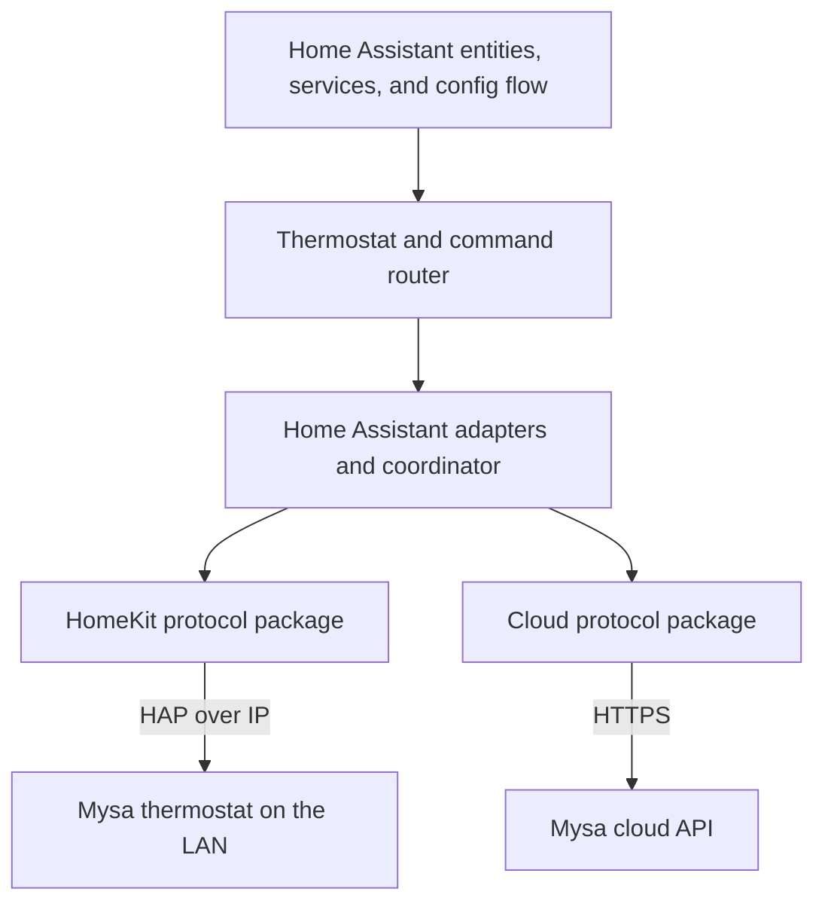

# Integration architecture

Mysa Local is one Home Assistant integration with two independent device
protocols. HomeKit is the preferred path for thermostat readings and control on
the LAN. The Mysa cloud adds settings and account features, and can provide a
fallback when the local connection is unavailable.

The protocol packages do not call each other. Home Assistant code coordinates
them through semantic device operations and state.

## Protocol implementations

`custom_components/mysa_local/protocols/cloud/` implements the Mysa cloud API.
It owns authentication, HTTP requests, cloud response models, endpoint and
payload details, cloud-specific enums, and cloud errors. Its public client
accepts operations such as setting a temperature or button lock; its command
helpers translate those operations into Mysa's wire format. The package has no
Home Assistant or HomeKit dependency.

`custom_components/mysa_local/protocols/homekit/` implements Mysa's HomeKit
thermostat behavior on top of `aiohomekit`. It owns HomeKit characteristic
identifiers, accessory parsing, value encoding, and protocol errors. Callers
use semantic fields such as `target_temperature` and `display_unit`; the
package interprets AIDs, IIDs, characteristic UUIDs, and HAP status codes.
Diagnostic error text may include a status code. The package has no Home
Assistant dependency.

The focused [cloud protocol guide](../custom_components/mysa_local/protocols/cloud/README.md)
and [HomeKit protocol guide](../custom_components/mysa_local/protocols/homekit/README.md)
explain each transport's request flow, module responsibilities, public API, and
failure handling.

These packages are bundled with the integration and installed together by
HACS; they are not separate PyPI distributions. The protocol modules do not
depend on Home Assistant. The normal `custom_components.mysa_local.protocols`
import path does initialize the parent package, which imports Home Assistant.
The protocol boundary test also loads the modules in isolation so it can verify
that the protocol code itself stays independent.

## Home Assistant integration layer

The integration layer owns lifecycle, policy, persistence, and presentation:

- `homekit_adapter.py` connects Home Assistant discovery, controller, and
  pairing lifecycle to the HomeKit protocol package.
- `local_adapter.py` adapts the HomeKit device to Home Assistant polling,
  subscriptions, availability, and shutdown.
- `cloud_coordinator.py` schedules cloud refreshes, retries, and cloud
  operations. It calls the cloud protocol client and publishes typed state to
  the integration.
- `thermostat.py` combines the two state sources and exposes semantic
  operations to entities and services.
- `command_router.py` serializes writes and handles local-first fallback and
  reconciliation when a delayed local write completes after a newer command.
- `pairing_store.py` persists pairing credentials and recovery state using HA
  storage. The HomeKit pairing flow receives pairing data and calls the HA
  persistence callback as soon as the accessory accepts a pairing, before any
  further network read.
- `config_flow.py` owns initial setup and HomeKit discovery, and registers the
  options and thermostat subentry handlers from `flows/`.
- `schedule.py` and platform entities implement schedule workflows and the
  Home Assistant user interface.

Entities should ask the thermostat layer to set brightness, a temperature
limit, a button lock, or another device setting. They should not construct
cloud request dictionaries or refer to HomeKit characteristic identifiers.
Protocol-specific request formatting belongs in the matching protocol
package; command ordering and source selection belong in the integration.

Cloud response models and enums are currently public types from
`protocols.cloud`, and the integration reads them for state and capability
display. They describe the cloud's data shape. A future domain-model layer
could make the integration independent of those response models, but that is a
separate refactor from separating the two transports.

### Setup and management flows

The flow modules separate the three entry points while sharing thermostat
operations:

- `config_flow.py` assembles the initial entry, including optional cloud
  sign-in and the queues of thermostats to pair or add to the account.
- `flows/subentry.py` adds and reconfigures individual thermostats, including
  names, account membership, local pairing, and heater settings.
- `flows/options.py` manages integration settings, the account overview, and
  sign-in/sign-out. `flows/account.py` owns shared sign-in schemas, credential
  handling, and the reauthentication steps inherited by the initial flow.
- `flows/thermostat.py` provides discovery, pairing recovery, HomeKit Device
  takeover, and account-linking steps reused by setup, subentries, and repairs.
- `flows/state.py` defines `ThermostatFlowState`. Each flow initializes its own
  instance through `ThermostatSteps.__init__`, so selections, pairing sessions,
  discovery maps, pending recoveries, and account choices have explicit defaults
  and cannot leak between flows. Initial-setup queues and pending subentries
  remain on the flow that owns them.
- `flows/shared.py` contains presentation, PIN validation, and entry helpers.
  Runtime startup imports its pairing-ID helper directly without loading the
  config-flow registration module.

Tests follow the same boundaries: initial setup in `test_config_flow.py`,
thermostat management in `test_subentry_flow.py`, options and authentication in
`test_options_flow.py`, and shared thermostat steps in `test_thermostat_flow.py`.
Account issues and their repair flows are covered by `test_repairs.py`.

## Testing the boundaries

Protocol tests exercise cloud authentication, parsing, and command encoding
with fixtures and mocked HTTP responses. HomeKit protocol tests use the
`aiohomekit` test accessory and verify that protocol identifiers and status
handling are translated to semantic fields. Neither protocol test suite needs
to contact a real Mysa device.

Home Assistant tests use fake cloud responses and fake HomeKit accessories to
check setup, entity behavior, fallback, write ordering, and recovery. They
should interact with the adapters or semantic device operations rather than
mutating the protocol adapter's internal caches.

Live-device checks are useful for confirming undocumented cloud payloads and
HomeKit behavior across firmware models. Keep them separate from routine test
runs: use reversible settings, restore the original values, and avoid pairing
or removal operations unless the test specifically requires them.

## Cloud protocol findings versus implementation

The [cloud tracker](implementation/cloud.md) owns the detailed implementation
work list. Cloud acquisition now reads structured and legacy state independently, preserving
per-field observations and source health. `cloud_state.py` selects values and
tracks pending commands separately from confirmed reports. The client provides
allowlisted host fallback and native schedule snapshots; the schedule journal
retains origin during clearing and rollback. Hardware confirmation remains
separate from code/fixture coverage.

Run `python3 tools/check_docs.py` for offline documentation checks. It does not
import the integration, obtain credentials, or contact any service or thermostat.
