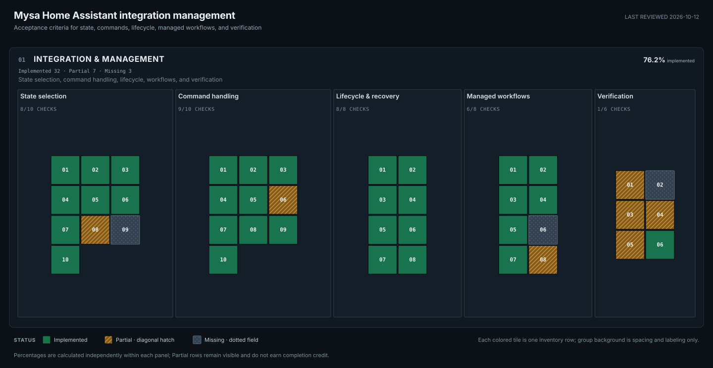

# Home Assistant integration and management coverage

Last reviewed: **2026-10-12**

Package baseline: **Mysa Local 0.5.2**

This tracker covers how the Home Assistant integration selects state, routes and
confirms commands, manages setup and recovery, and verifies model behavior. The
standalone [Mysa client API inventory](https://github.com/SokolskyNikita/mysa-client/blob/main/docs/api-coverage.md)
owns direct request methods, codecs, parsers, and protocol evidence. The two
maps have independent rows and percentages.

<!-- api-progress:start -->

**01 Integration & management:** 32 of 42 known rows fully implemented (76.2%). Partial: 7; missing: 3.

| Layer | Category | Implemented | Partial | Missing | Total |
| --- | --- | ---: | ---: | ---: | ---: |
| Integration & management | State selection | 8 | 1 | 1 | 10 |
| Integration & management | Command handling | 9 | 1 | 0 | 10 |
| Integration & management | Lifecycle & recovery | 8 | 0 | 0 | 8 |
| Integration & management | Managed workflows | 6 | 1 | 1 | 8 |
| Integration & management | Verification | 1 | 4 | 1 | 6 |
<!-- api-progress:end -->

[Open the management map at full size](management-progress.svg). Each tile is
one HA acceptance row; the tooltip gives its stable ID, requirement, and status.
Empty layout space is not a missing requirement.

## How to read the map

| Status | Meaning |
| --- | --- |
| Implemented | The named integration behavior is implemented with the cited regression or validation evidence. |
| Partial | Useful handling exists, but a named correctness, workflow, or validation gap remains. |
| Missing | The named requirement has not been implemented or demonstrated. |

Only **Implemented** counts toward the management percentage. It measures the
explicit acceptance rows below, including hardware validation obligations; it
does not mean bug-free or support for every Mysa model. Adding a newly found
requirement can lower the score.

## Scope and evidence

These rows cover the current integration's state selection, command handling,
lifecycle, managed workflows, and verification obligations. They do not repeat
the client method inventory or invent an integration requirement for every
unsupported Mysa app feature. Raw API support does not itself prove source
selection, command confirmation, model suitability, or physical behavior.

The strongest live evidence remains two Baseboard Lites (`BB-V2-0-L`, firmware
`3.17.5.13`) observed October 10–12. AC, In-floor and other baseboard variants
need matching hardware checks. V3, Central HVAC and Climate Sensor support is
experimental, with app-derived mappings and synthetic fixtures. Newer credential
transfer, fleet OTA and Matter also lack matching hardware validation.

## Integration and management inventory

IDs beginning with `MGT-` are stable requirement identifiers. Each row names
integration behavior or an acceptance criterion and links to its code, regression
evidence, and explicit remaining gaps.

### STATE — source selection and trustworthy state

| ID | Concrete requirement | Status | Linked code/tests and explicit remaining gaps |
| --- | --- | --- | --- |
| MGT-STATE-01 | Prefer a healthy local HomeKit temperature/action path; switch to cloud state when essential local reads fail. | Implemented | [Thermostat source selection](../../custom_components/mysa_local/thermostat.py), [local-read fallback regressions](../../tests/test_local_read_errors.py#L71), [routing regressions](../../tests/test_routing.py#L48). Local HomeKit reads have no independent sensor timestamp; remote-sensor arbitration is tracked in MGT-STATE-08. |
| MGT-STATE-02 | Use cloud telemetry as fallback only when the thermostat is online and the measurement clock is fresh; make stale fallback values unavailable and recover on a fresh report. | Implemented | [Freshness policy](../../custom_components/mysa_local/cloud_coordinator.py), [climate selection](../../custom_components/mysa_local/thermostat.py), [freshness regressions](../../tests/test_telemetry_freshness.py#L74), [recovery regression](../../tests/test_telemetry_freshness.py#L101). Clocks skewed by more than 24 hours remain open in MGT-STATE-09. |
| MGT-STATE-03 | Retain missing fields at their original observation age and let a successful independent source update without refreshing stale siblings. | Implemented | [Per-field reconciliation](../../custom_components/mysa_local/cloud_state.py), [coordinator acquisition](../../custom_components/mysa_local/cloud_coordinator.py), [independent-source and age regressions](../../tests/test_cloud_completion.py#L248). Hardware timing remains separate in MGT-QUALITY-01/02. |
| MGT-STATE-04 | Select each cloud field from valid reported observations using its own normalized source timestamp; reject invalid/future and desired-only values. | Implemented | [Observation reconciliation](../../custom_components/mysa_local/cloud_state.py), [timestamp/source regression](../../tests/test_cloud_completion.py#L107), [parser regression](../../tests/test_cloud_completion.py#L88). A large but plausible clock skew still needs the explicit fallback in MGT-STATE-09. |
| MGT-STATE-05 | Track humidity freshness independently from temperature and publish it only when its own cloud observation is usable. | Implemented | [Humidity property](../../custom_components/mysa_local/thermostat.py), [sensor entities](../../custom_components/mysa_local/sensor.py), [stale fallback regression](../../tests/test_telemetry_freshness.py#L159), [humidity entity regression](../../tests/test_features.py#L460). HomeKit humidity is not part of the observed Lite profile. |
| MGT-STATE-06 | Select coherent paired limits and brightness from a single candidate source; do not mix a lone structured bound with an unrelated record bound. | Implemented | [Pair selection](../../custom_components/mysa_local/cloud_state.py), [mixed-bound regression](../../tests/test_cloud_completion.py#L340), [setpoint precedence regressions](../../tests/test_setpoint_limits.py). |
| MGT-STATE-07 | Derive HVAC action from fresh reported stages/state bits; return unknown on missing or contradictory evidence instead of inferring action from selected mode. | Implemented | [HVAC action selection](../../custom_components/mysa_local/thermostat.py), [synthetic HVAC activity regression](../../tests/test_new_cloud_models.py#L183). This path is app-derived and still needs matching HVAC hardware evidence in MGT-QUALITY-02. |
| MGT-STATE-08 | Select the best applicable room-temperature source across local/cloud and any linked Mysa sensor, with explicit priority, freshness, and user-visible selection rules. | Partial | [Current local-over-cloud selection](../../custom_components/mysa_local/thermostat.py), [remote-temperature tracker](https://github.com/SokolskyNikita/mysa-client/blob/main/docs/cloud-state.md#remote-temperature-tracking), [new-model deferrals](../new-cloud-models.md#deferred-features). Current policy is healthy local HomeKit first, then fresh cloud telemetry; linked/remote sensor setup and preference/arbitration are unsupported. |
| MGT-STATE-09 | Tolerate a device clock more than 24 hours ahead or behind using receipt-time-minus-five-minutes, with a per-device enabled default, diagnostics, and return to reported time after recovery. | Missing | [Current timestamp selection](https://github.com/SokolskyNikita/mysa-client/blob/main/src/mysa_client/cloud/observations.py), [freshness policy](../../custom_components/mysa_local/cloud_coordinator.py), [existing timestamp regression](../../tests/test_cloud_completion.py#L107). Existing code rejects some invalid/future clocks; the per-device setting, greater-than-24-hour receipt-time-minus-five-minute fallback, diagnostic provenance, and recovery behavior are not implemented. |
| MGT-STATE-10 | Keep connection status separate from measurement freshness: online must not make old readings fresh, and stale telemetry must not hide otherwise connected cloud settings. | Implemented | [Coordinator status/freshness](../../custom_components/mysa_local/cloud_coordinator.py), [regressions](../../tests/test_telemetry_freshness.py#L121) and [settings availability regression](../../tests/test_telemetry_freshness.py#L159). |

### COMMAND — routing, validation, and confirmation

| ID | Concrete requirement | Status | Linked code/tests and explicit remaining gaps |
| --- | --- | --- | --- |
| MGT-COMMAND-01 | Route supported writes locally first when HomeKit is healthy; avoid a cloud write after a successful local command. | Implemented | [Command router](../../custom_components/mysa_local/command_router.py), [local-only write regression](../../tests/test_routing.py#L48). Some operations are intentionally cloud-only. |
| MGT-COMMAND-02 | For an uncertain local write, read back before cloud fallback; do not replay a rejected or already-applied command through a second path. | Implemented | [Router uncertainty handling](../../custom_components/mysa_local/command_router.py), [timed-out local readback regressions](../../tests/test_routing.py#L57), [no duplicate after rejection](../../tests/test_routing.py#L106). Physical command effects still need hardware diagnosis in MGT-QUALITY-03. |
| MGT-COMMAND-03 | Serialize commands per thermostat and reassert the latest user intent after an older timed-out local write settles. | Implemented | [Router ordering/reconciliation](../../custom_components/mysa_local/command_router.py), [late-write regressions](../../tests/test_write_ordering.py#L22), [simultaneous command regression](../../tests/test_write_ordering.py#L107). |
| MGT-COMMAND-04 | Keep accepted, ambiguous, stored, reported, unchanged, confirmed, and expired command outcomes distinct; never publish an accepted request as device state. | Implemented | [Pending command model](../../custom_components/mysa_local/cloud_state.py), [cloud completion regressions](../../tests/test_cloud_completion.py#L155), [storage-versus-physical confirmation regression](../../tests/test_cloud_completion.py#L443). |
| MGT-COMMAND-05 | Bound cloud readback retries; do not resend an ambiguous write to another host or treat rate limiting as permission to replay. | Implemented | [Cloud fallback and retry policy](../../custom_components/mysa_local/cloud_coordinator.py), [bounded readback regressions](../../tests/test_cloud_completion.py#L414), [ambiguous-host regressions](../../tests/test_cloud_completion.py#L218), [fallback recovery regression](../../tests/test_cloud_completion.py#L182). |
| MGT-COMMAND-06 | Apply one capability-aware validation policy across climate commands, holds, schedules, and settings; validate every schedule event before mutating cloud state. | Partial | [Current newer-model validator](https://github.com/SokolskyNikita/mysa-client/blob/main/src/mysa_client/cloud/validation.py), [thermostat command boundaries](../../custom_components/mysa_local/thermostat.py), [schedule malformed-input regression](../../tests/test_cloud_completion.py#L284). Older-model limits/modes, holds, and all entry points still need consistent central validation; the current validator covers only the newer-model command boundary. |
| MGT-COMMAND-07 | On newer models, expose only advertised modes and controls; reject missing capabilities, unsupported model operations, and out-of-range targets. | Implemented | [Capability validation](https://github.com/SokolskyNikita/mysa-client/blob/main/src/mysa_client/cloud/validation.py), [new-model entity/control regressions](../../tests/test_new_cloud_models.py#L218) and [validation regressions](../../tests/test_new_cloud_models.py#L314). Tests use synthetic app-derived fixtures; see MGT-QUALITY-02. |
| MGT-COMMAND-08 | Treat Central HVAC heat/cool AUTO as one validated mode update with both targets, mode-specific bounds, and minimum deadband; reject partial pairs before sending. | Implemented | [Thermostat HVAC command validation](../../custom_components/mysa_local/thermostat.py), [HVAC command regressions](../../tests/test_new_cloud_models.py#L120). Hardware validation remains open. |
| MGT-COMMAND-09 | Convert Fahrenheit-facing HA commands and display steps consistently while preserving valid Celsius wire precision. | Implemented | [Temperature handling](../../custom_components/mysa_local/thermostat.py), [unit regressions](../../tests/test_temperature_units.py#L62), [display step regression](../../tests/test_temperature_units.py#L37). |
| MGT-COMMAND-10 | Show and send AC fan/swing operations only when the discovered remote supports those exact commands; hide them when off or unsupported. | Implemented | [AC entity/control logic](../../custom_components/mysa_local/thermostat.py), [AC capability regressions](../../tests/test_ac.py#L153), [unsupported-model entity regression](../../tests/test_ac.py#L187), [remote command filtering](../../tests/test_ac.py#L213). |

### LIFECYCLE — setup, recovery, persistence, and shutdown

| ID | Concrete requirement | Status | Linked code/tests and explicit remaining gaps |
| --- | --- | --- | --- |
| MGT-LIFECYCLE-01 | Share the HomeKit controller through HA runtime and stop it with the HA lifecycle. | Implemented | [HA HomeKit adapter](../../custom_components/mysa_local/homekit_adapter.py), [shared-controller lifecycle regression](../../tests/test_homekit.py#L14). |
| MGT-LIFECYCLE-02 | Keep polling available when subscriptions fail; close local sessions and cancel refresh/reconciliation work on unload. | Implemented | [Local adapter lifecycle](../../custom_components/mysa_local/local_adapter.py), [subscription failure and removed-value regression](https://github.com/SokolskyNikita/mysa-client/blob/main/tests/homekit/test_homekit_refresh.py#L136), [refresh cancellation regression](../../tests/test_homekit_refresh.py#L102), [pending-write unload regression](../../tests/test_write_ordering.py#L148). |
| MGT-LIFECYCLE-03 | Mark the local path unavailable on failed/missing essential reads, but tolerate optional-field failures; an error notification cannot restore health by itself. | Implemented | [Read health policy](../../custom_components/mysa_local/local_adapter.py), [read error regressions](../../tests/test_local_read_errors.py#L90), [optional field regression](../../tests/test_local_read_errors.py#L109), [event health regression](../../tests/test_local_read_errors.py#L126). |
| MGT-LIFECYCLE-04 | Refresh HomeKit characteristic addresses, supported modes, ranges, and subscriptions on configuration changes/reconnects, with bounded retry and stale-field removal. | Implemented | [Refresh implementation](https://github.com/SokolskyNikita/mysa-client/blob/main/src/mysa_client/homekit/device.py), [refresh tracker criteria](homekit.md#hk-a01-criteria), [refresh regressions](../../tests/test_homekit_refresh.py#L45), [bounded retry regression](../../tests/test_homekit_refresh.py#L85). |
| MGT-LIFECYCLE-05 | After an offline local-only start, publish newly discovered capability entities once local recovery succeeds; remove listeners on unload. | Implemented | [Entity discovery helper](../../custom_components/mysa_local/entity.py), [HomeKit recovery criteria](homekit.md#hk-a02-criteria), [offline recovery regression](../../tests/test_homekit_refresh.py#L36). |
| MGT-LIFECYCLE-06 | Persist an accepted HomeKit pairing before further accessory reads and attempt bounded key cleanup if persistence fails. | Implemented | [Pairing/session code](https://github.com/SokolskyNikita/mysa-client/blob/main/src/mysa_client/homekit/controller.py), [persist-before-read regression](https://github.com/SokolskyNikita/mysa-client/blob/main/tests/homekit/test_homekit_protocol.py#L155), [storage-failure rollback regression](https://github.com/SokolskyNikita/mysa-client/blob/main/tests/homekit/test_homekit_protocol.py#L181), [pairing failure regressions](https://github.com/SokolskyNikita/mysa-client/blob/main/tests/homekit/test_pairing_protocol_failures.py#L34). A failed rollback against an unreachable device remains a documented limitation. |
| MGT-LIFECYCLE-07 | Preserve an interrupted HomeKit Device migration marker and retry without losing destination entities or unrelated device metadata. | Implemented | [Migration handler](../../custom_components/mysa_local/migration.py), [migration criteria](homekit.md#hk-a03-criteria), [migration retry regressions](../../tests/test_migration.py#L36) and [partial takeover regression](../../tests/test_migration.py#L89). |
| MGT-LIFECYCLE-08 | Journal schedule replacement/clear operations so failure, cancellation, shared attachments, app edits, and restart recovery do not lose unrelated schedules. | Implemented | [Schedule recovery implementation](../../custom_components/mysa_local/schedule.py), [recovery tests](../../tests/test_schedule_recovery.py#L246), [restart recovery](../../tests/test_schedule_recovery.py#L284), [shared schedule preservation](../../tests/test_schedule_recovery.py#L375). Extracting the journal into a smaller component is maintainability work only; no separate credit is counted while the safety behavior is covered. |

### WORKFLOW — account/device management and model scope

| ID | Concrete requirement | Status | Linked code/tests and explicit remaining gaps |
| --- | --- | --- | --- |
| MGT-WORKFLOW-01 | Let the user add an already-enrolled account device and match local discovery to the correct cloud record without duplicating an existing device. | Implemented | [Account/device flow](../../custom_components/mysa_local/flows/thermostat.py), [configured-device discovery regression](../../tests/test_config_flow.py#L153), [subentry account flow regressions](../../tests/test_subentry_flow.py#L117). |
| MGT-WORKFLOW-02 | Gate entity creation on real capability data; do not default to heating controls when capabilities are missing, and create supported entities after later capability recovery. | Implemented | [Entity factories](../../custom_components/mysa_local/entity.py), [missing-capability regression](../../tests/test_new_cloud_models.py#L218), [partial-capability regression](../../tests/test_new_cloud_models.py#L444), [local recovery regression](../../tests/test_homekit_refresh.py#L36). |
| MGT-WORKFLOW-03 | Keep Climate Sensor read-only and prevent Central HVAC/Baseboard V3 from receiving legacy-only schedules, holds, heater configuration, and OTA entities. | Implemented | [Family-gated thermostat/entity behavior](../../custom_components/mysa_local/thermostat.py), [no-extras regression for all three newer families](../../tests/test_new_cloud_models.py#L54), [mixed account regression](../../tests/test_new_cloud_models.py#L345). |
| MGT-WORKFLOW-04 | Import app-enrolled newer devices through cloud account setup, clearly mark their support experimental, and avoid asking them for HomeKit pairing. | Implemented | [New-model setup scope](../new-cloud-models.md), [cloud-only setup regressions](../../tests/test_config_flow.py#L232), [experimental import and diagnostics regression](../../tests/test_new_cloud_models.py#L54). Hardware validation remains open in MGT-QUALITY-02. |
| MGT-WORKFLOW-05 | Recover account membership and pairing conflicts through explicit repair/setup steps without silently deleting or claiming another device. | Implemented | [Repair flows](../../custom_components/mysa_local/repairs.py), [repair regressions](../../tests/test_repairs.py#L36), [cloud-only account repair](../../tests/test_repairs.py#L87), [claim/setup scope](../cloud-workflows.md#claiming-an-older-model). Never-owned device claim behavior remains unverified in the cloud workflow notes. |
| MGT-WORKFLOW-06 | Manage newer-model initial provisioning and fleet ownership end to end, including credential transfer, claim/finalization, and update lifecycle. | Missing | [Current account import boundary](../cloud-workflows.md#baseboard-v3-central-hvac-and-climate-sensor), [new-model deferrals](../new-cloud-models.md#deferred-features), [tracked cloud gap](cloud.md#c-p14). The HA workflow starts only after the user has completed setup/enrollment in Mysa's app; no matching credential-transfer or fleet finalization flow is implemented. |
| MGT-WORKFLOW-07 | Make experimental/support status and operational limits discoverable in device information and diagnostics without leaking account/device identifiers. | Implemented | [Device model/support label](../../custom_components/mysa_local/thermostat.py), [diagnostic redaction](../../custom_components/mysa_local/diagnostics.py), [diagnostic regression](../../tests/test_new_cloud_models.py#L54), [redaction regression](../../tests/test_features.py#L356). |
| MGT-WORKFLOW-08 | Remove a device with complete cleanup of its schedule attachments, shortcut actions, sensor links and group membership, preserving unrelated devices. | Partial | [Removal workflow](../cloud-workflows.md#deletion-and-re-addition), [account cleanup](../../custom_components/mysa_local/account.py#L114), [removal regression](../../tests/test_subentry_flow.py#L173). Schedule/shortcut cleanup is best effort and record deletion proceeds after a cleanup error; sensor-link/group cleanup and newer-model removal remain incomplete. |

### QUALITY — validation, gaps, and evidence limits

| ID | Concrete requirement | Status | Linked code/tests and explicit remaining gaps |
| --- | --- | --- | --- |
| MGT-QUALITY-01 | On both observed Baseboard Lite devices, exercise local/cloud dual-source reads under healthy-local, local-unavailable, fresh-cloud, stale-cloud, and offline-cloud conditions; verify diagnostics identify the selected source and cloud observations remain available while HomeKit is active. | Partial | [Current hardware limits](progress.md#research-and-hardware-limits), [cloud validation notes](cloud.md), [telemetry regressions](../../tests/test_telemetry_freshness.py). Two Lite devices have been observed, but this condition matrix and its evidence log are incomplete. Command application discrepancy is tracked separately in MGT-QUALITY-03. |
| MGT-QUALITY-02 | Validate each remaining supported profile on matching hardware: non-Lite Baseboard generations, In-floor, Mini-Split AC, Baseboard V3, Central HVAC, and Climate Sensor. Confirm only applicable advertised controls appear, compare state and reversible writes with the Mysa app/device, and record model/firmware-specific exceptions. | Missing | [Current hardware limits](progress.md#research-and-hardware-limits), [newer-model evidence and test limits](../new-cloud-models.md#evidence-and-automated-tests), [synthetic newer-model regressions](../../tests/test_new_cloud_models.py). The tested Lite profile does not cover these models; newer-model fixtures are app-derived, not hardware captures. Keep newer-model support marked experimental until its applicable device checks pass. |
| MGT-QUALITY-03 | Explain and resolve the observed case where one Lite accepted cloud setpoint/OFF commands without a confirmed local change while another applied them. | Partial | [Cloud confirmation criteria and known hardware limit](cloud.md#c-a05), [confirmation regression](../../tests/test_cloud_completion.py#L443). The cause and any reliable recovery procedure remain unknown; determine whether this is device/firmware behavior, cloud acceptance semantics, or a timing/recovery issue. |
| MGT-QUALITY-04 | Verify an offered firmware release through trigger, status, installation, and installed-version transition on hardware. | Partial | [Cloud firmware trigger criteria](cloud.md#c-a01), [trigger implementation](../../custom_components/mysa_local/cloud_coordinator.py), [opt-in firmware regression](../../tests/test_features.py#L385). The request path and user opt-in behavior are covered; no available release has been installed for end-to-end validation. |
| MGT-QUALITY-05 | Calculate daily runtime/derived energy across spring-forward and fall-back transitions using elapsed UTC time while keeping local calendar-day boundaries. | Partial | [Runtime aggregation](../../custom_components/mysa_local/thermostat.py), [current runtime regression](../../tests/test_features.py#L163). Runtime still uses local-calendar calculations around daylight-saving changes; UTC elapsed-time handling and regressions for both transitions are outstanding. |
| MGT-QUALITY-06 | Expose enough source/age/request/command diagnostics to explain selected data and failures while redacting credentials and household identifiers. | Implemented | [Cloud diagnostics](../../custom_components/mysa_local/diagnostics.py), [source diagnostics regression](../../tests/test_cloud_completion.py#L248), [redaction regression](../../tests/test_features.py#L356). This supports investigation; it does not imply that all bugs are known or absent. |

## Research and hardware limits

The recovered Android app comparison (3.54.1 versus 4.20.1) identifies extended
physical lock modes, `/ac/remote-match/`, `/mysa-legacy/{device}/ac-sync`, and IR
setup/delivery workflows. Their raw route inventory is in client
[API-SETUP-09](https://github.com/SokolskyNikita/mysa-client/blob/main/docs/api-coverage.md#api-setup-09)
and [API-WRITE-19](https://github.com/SokolskyNikita/mysa-client/blob/main/docs/api-coverage.md#api-write-19).
These are known feature gaps, not validated payload contracts. A route name does
not establish a working PIN or remote-setup method.

The strongest live evidence remains two Baseboard Lites (`BB-V2-0-L`, firmware
`3.17.5.13`) observed October 10–12. Selected local/cloud controls and schedule
workflows were exercised. Cloud setpoint/mode application differed between the
devices, and no offered firmware release was installed during these checks.

AC, In-floor and other baseboard variants need matching hardware checks. V3,
Central HVAC and Climate Sensor support is experimental, with app-derived
mappings and synthetic fixtures. Newer credential transfer, fleet OTA and Matter
also lack matching hardware validation. See [cloud validation](cloud.md),
[HomeKit evidence](homekit.md#evidence-and-maintenance), and
[newer-model evidence](../new-cloud-models.md#evidence-and-automated-tests).

## Outside the inventories

- Account/profile administration, invitations, permissions, account migration,
  Alexa linking and property-manager services.
- Analytics, localization, feature flags, phone diagnostic uploads and general
  app communication preferences; device notification operations remain included.
- Obsolete credential helpers as extra features, duplicate endpoint aliases,
  and device-internal firmware-download behavior. MQTT is documented separately
  from the HTTP, HomeKit, and setup API inventory. See the [HA MQTT guide](../mqtt.md)
  for integration behavior and hardware evidence, and the [client MQTT guide](https://github.com/SokolskyNikita/mysa-client/blob/main/docs/mqtt.md)
  for protocol details.
- Unknown-purpose HomeKit/GATT fields, speculative reboot commands and unobserved
  Matter vendor extensions. Add operations when their meaning is established.
- A generic “no bugs” item or a count of passed tests masquerading as correctness.
  Management items need bounded acceptance criteria and evidence.

## Keeping the map current

Update the management row and its code/test evidence together. Preserve MGT-*
identifiers when scope or status changes; add a new stable ID for a new
acceptance criterion. Keep API method support separate from orchestration and
validation. Run `python3 tools/update_api_progress.py` to regenerate the HA
summary and map, then run it with `--check` and `python3 tools/check_docs.py`.
The generator reads only this repository and does not contact a thermostat.

### Baseline history

- **2026-10-12, initial:** one aggregate feature-group score mixed protocol methods with integration behavior.
- **2026-10-12, revised:** split the raw API inventory into the standalone
  client repository and kept HA acceptance criteria here. The maps have
  independent denominators; their scores are not comparable to the earlier
  aggregate. This is a documentation change.
