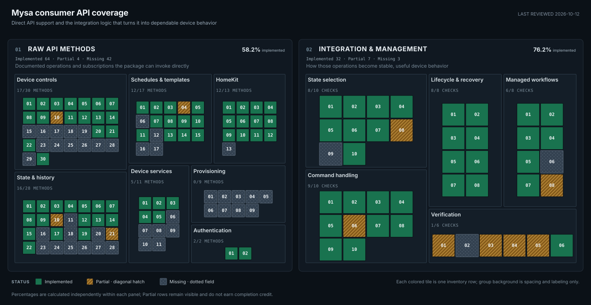

# Consumer device API coverage

Last reviewed: **2026-10-12**

Package baseline: **Mysa Local 0.5.1**

Two different questions, tracked independently:

1. **Raw API methods:** can the package make the request, encode the command,
   read the response, or receive the notification?
2. **Integration and management:** does it choose the right observation, route
   and confirm commands correctly, recover from failures, and meet the listed
   regression and validation requirements?

<!-- api-progress:start -->

**01 Raw API methods:** 64 of 110 known rows fully implemented (58.2%). Partial: 4; missing: 42.

**02 Integration & management:** 32 of 42 known rows fully implemented (76.2%). Partial: 7; missing: 3.

| Layer | Category | Implemented | Partial | Missing | Total |
| --- | --- | ---: | ---: | ---: | ---: |
| Raw API methods | Authentication | 2 | 0 | 0 | 2 |
| Raw API methods | State & history | 16 | 2 | 10 | 28 |
| Raw API methods | Device controls | 17 | 1 | 12 | 30 |
| Raw API methods | Schedules & templates | 12 | 1 | 4 | 17 |
| Raw API methods | Device services | 5 | 0 | 6 | 11 |
| Raw API methods | HomeKit | 12 | 0 | 1 | 13 |
| Raw API methods | Provisioning | 0 | 0 | 9 | 9 |
| Integration & management | State selection | 8 | 1 | 1 | 10 |
| Integration & management | Command handling | 9 | 1 | 0 | 10 |
| Integration & management | Lifecycle & recovery | 8 | 0 | 0 | 8 |
| Integration & management | Managed workflows | 6 | 1 | 1 | 8 |
| Integration & management | Verification | 1 | 4 | 1 | 6 |
<!-- api-progress:end -->

[Open the coverage map at full size](api-progress.svg). Each numbered tile is one
inventory row, grouped by responsibility; tile titles in the standalone SVG give
the full ID, operation and status. Empty layout space is not a missing item.
The two panels have independent denominators and are not combined into one score.

## How to read the maps

| Status | Raw API methods | Integration and management |
| --- | --- | --- |
| Implemented | A callable wrapper, named codec/accessor, or notification interface provides the listed operation. | The named behavior is implemented and has the cited regression or validation evidence. |
| Partial | Some of the named operation is available; its remaining method-level gap is explicit. | Useful handling exists, but a named correctness, workflow, or validation gap remains. |
| Missing | This package has no supported implementation of the operation. | The named requirement has not been implemented or demonstrated. |

Only **Implemented** counts toward each headline percentage:
`100 × implemented rows / all rows in that panel`, rounded to one decimal place.
Partial tiles remain visible without invented half-credit. All rows within a
panel have equal weight; this measures breadth, not effort, severity or usage.

For example, a heater-profile encoder can be implemented on the left while
model-aware selection and validation still need work on the right. Receiving two
temperature readings is an API capability; deciding which is fresh and usable
is integration management. A successful cloud write does not itself establish
that the device applied the command.

**Neither score means “bug-free” or “works on every device.”** The management map
tracks explicit acceptance criteria and known gaps, including outstanding
hardware checks. Completing every listed criterion would not prove that no
unknown bugs remain. Adding a newly found operation or defect can lower a score.

## Scope and evidence

The raw inventory covers known consumer device APIs across Baseboard V1/V2/Lite/V3,
In-floor, Mini-Split AC, Central HVAC, and Climate Sensor where applicable. The
management inventory covers the current integration's state selection, command
handling, lifecycle, workflows, and verification obligations. It does not invent
an orchestration requirement for every unsupported app feature.

The baseline comes from the October 10–12 research, recovered app behavior, and
current code/tests. Known consumer device operations remain in the raw inventory
even when the HA roadmap intentionally excludes them. Code in the separate Wi-Fi
setup product or HA's built-in Matter integration does not count as implementation
inside this package.

Count equivalent S/R/L host aliases once. Distinct protocol operations such as
structured versus legacy state acquisition and authenticated HomeKit sessions
remain separate. Rows count named methods or bounded operation families; related
CRUD variants may share a row and are complete only when all listed variants
exist. Generic raw state/settings updates are primitives, not blanket support
for every possible device field. Hardware-inapplicable features do not become
requirements for every model.

The detailed [cloud](cloud.md) and [HomeKit](homekit.md) trackers own protocol
implementation decisions. [Architecture](../architecture.md) explains where the
management layer lives. The inventories below link to those references and to
specific code/tests; the generator only counts the reviewed statuses.

## Raw API method inventory

IDs beginning with `API-` belong to the first panel. Rows identify a method or
bounded protocol operation, not an entire end-user feature or a Python line count.

### Authentication

| ID | Operation | Status | Evidence and remaining gap |
| --- | --- | --- | --- |
| API-AUTH-01 | Cognito email/password sign-in using SRP | Implemented | [auth.py](https://github.com/SokolskyNikita/mysa-client/blob/main/src/mysa_client/cloud/auth.py) implements InitiateAuth and RespondToAuthChallenge; protocol and body tests are in [test_srp.py](https://github.com/SokolskyNikita/mysa-client/blob/main/tests/cloud/test_srp.py) and [test_client.py](https://github.com/SokolskyNikita/mysa-client/blob/main/tests/cloud/test_client.py). |
| API-AUTH-02 | Cognito refresh-token exchange and ID-token renewal | Implemented | [auth.py](https://github.com/SokolskyNikita/mysa-client/blob/main/src/mysa_client/cloud/auth.py) refreshes ID tokens and exposes replacement refresh tokens through its callback; persistence remains caller-owned. |

### State and history

| ID | Operation | Status | Evidence and remaining gap |
| --- | --- | --- | --- |
| API-READ-01 | Read structured state for a batch of device IDs | Implemented | [client.py](https://github.com/SokolskyNikita/mysa-client/blob/main/src/mysa_client/cloud/client.py) get_states() calls POST /state/batch, retains per-device failures, and parses each returned state. |
| API-READ-02 | Read structured state for one device | Implemented | [client.py](https://github.com/SokolskyNikita/mysa-client/blob/main/src/mysa_client/cloud/client.py) get_state() calls GET /state/{id}; this differs from batch state and legacy telemetry. |
| API-READ-03 | Read legacy live state for a batch of devices | Implemented | [client.py](https://github.com/SokolskyNikita/mysa-client/blob/main/src/mysa_client/cloud/client.py) get_legacy_states() parses GET /devices/state with per-field clocks; R and L host copies count once. |
| API-READ-04 | Parse room temperature and humidity readings | Implemented | [models.py](https://github.com/SokolskyNikita/mysa-client/blob/main/src/mysa_client/cloud/models.py) names and parses structured and legacy fields; humidity remains model/source dependent. |
| API-READ-05 | Parse operating mode and heat/cool/AUTO targets | Implemented | [models.py](https://github.com/SokolskyNikita/mysa-client/blob/main/src/mysa_client/cloud/models.py) parses structured target/mode fields and legacy setpoint/mode values. The AUTO target pair is a structured-state capability; source arbitration is assessed separately. |
| API-READ-06 | Parse Mini-Split AC target, fan speed, and swing state | Implemented | [models.py](https://github.com/SokolskyNikita/mysa-client/blob/main/src/mysa_client/cloud/models.py) parses structured target/fan/swing state and AC remote capabilities. This row covers the known structured control-state fields; legacy data need not contain the same fields. |
| API-READ-07 | Parse Central HVAC mode, AUTO pair, stages, and fan configuration | Implemented | [models.py](https://github.com/SokolskyNikita/mysa-client/blob/main/src/mysa_client/cloud/models.py) parses known structured HVAC state and capability fields; code mappings are experimental and model-gated. |
| API-READ-08 | Parse heating activity and HVAC fan runtime | Implemented | [models.py](https://github.com/SokolskyNikita/mysa-client/blob/main/src/mysa_client/cloud/models.py) names duty cycle, HVAC stage, and fan runtime/configuration fields; interval duty is not an instantaneous relay reading. |
| API-READ-09 | Parse connection status and observation timestamps | Implemented | [models.py](https://github.com/SokolskyNikita/mysa-client/blob/main/src/mysa_client/cloud/models.py) and [observations.py](https://github.com/SokolskyNikita/mysa-client/blob/main/src/mysa_client/cloud/observations.py) preserve source-specific timestamps and connection time; freshness arbitration is outside this panel. |
| API-READ-10 | Parse RSSI, internal temperatures, and free heap | Partial | RSSI is a named field in [models.py](https://github.com/SokolskyNikita/mysa-client/blob/main/src/mysa_client/cloud/models.py); internal temperatures and free heap remain in retained raw payloads without named accessors. |
| API-READ-11 | Parse measured voltage, current, power, and energy telemetry | Missing | The structured response is retained by [models.py](https://github.com/SokolskyNikita/mysa-client/blob/main/src/mysa_client/cloud/models.py), but these measurements lack named typed accessors; runtime estimates do not count as measured electrical data. |
| API-READ-12 | Read model, firmware, name, time zone, and stored device settings | Implemented | [models.py](https://github.com/SokolskyNikita/mysa-client/blob/main/src/mysa_client/cloud/models.py) DeviceRecord, DeviceState, and FirmwareInfo expose supported metadata fields from bootstrap/state/records. |
| API-READ-13 | Read per-device capabilities, ranges, and model features | Implemented | [client.py](https://github.com/SokolskyNikita/mysa-client/blob/main/src/mysa_client/cloud/client.py) get_capabilities() and [models.py](https://github.com/SokolskyNikita/mysa-client/blob/main/src/mysa_client/cloud/models.py) Capabilities.from_api() decode GET /capabilities/{id}; some app flags remain model-dependent. |
| API-READ-14 | Read AC remote-supported modes, fan speeds, swing, and modified keys | Implemented | [models.py](https://github.com/SokolskyNikita/mysa-client/blob/main/src/mysa_client/cloud/models.py) DeviceRecord provides named AC capability accessors; actual remote setup/matching is a separate missing operation. |
| API-READ-15 | Read runtime and temperature usage summaries | Implemented | [client.py](https://github.com/SokolskyNikita/mysa-client/blob/main/src/mysa_client/cloud/client.py) get_usage() and [models.py](https://github.com/SokolskyNikita/mysa-client/blob/main/src/mysa_client/cloud/models.py) UsageDay parse summary buckets from /telemetry/usage/{id}. |
| API-READ-16 | Read detailed raw measurement history | Missing | Research identifies POST /batchReadings/v2/{id}; [client.py](https://github.com/SokolskyNikita/mysa-client/blob/main/src/mysa_client/cloud/client.py) has no wrapper or parser for that request. |
| API-READ-17 | Read state-change history | Implemented | [client.py](https://github.com/SokolskyNikita/mysa-client/blob/main/src/mysa_client/cloud/client.py) get_state_history() parses timestamped changes from GET /state/history/{id}. |
| API-READ-18 | Read legacy target/setpoint history | Missing | The legacy POST /energy/setpoints/device/{id} query is documented in the [cloud protocol reference](https://github.com/SokolskyNikita/mysa-client/blob/main/src/mysa_client/cloud/README.md); no matching wrapper/parser exists. |
| API-READ-19 | Read offered firmware update and installed/allowed versions | Implemented | [client.py](https://github.com/SokolskyNikita/mysa-client/blob/main/src/mysa_client/cloud/client.py) get_firmware_info() and [models.py](https://github.com/SokolskyNikita/mysa-client/blob/main/src/mysa_client/cloud/models.py) FirmwareInfo parse GET /devices/update_available/{id}. |
| API-READ-20 | Read the firmware version catalog | Missing | The app route GET /devices/firmware is identified in [Firmware reference](../firmware-and-connectivity.md#legacy-devices); the client only reads per-device availability. |
| API-READ-21 | Read demand-response event state | Partial | Structured drState.inEvent is parsed by [models.py](https://github.com/SokolskyNikita/mysa-client/blob/main/src/mysa_client/cloud/models.py); the separate GET /devices/{id}/drstate fallback has no wrapper. |
| API-READ-22 | Read Home/Away/Vacation shortcuts | Implemented | [client.py](https://github.com/SokolskyNikita/mysa-client/blob/main/src/mysa_client/cloud/client.py) get_shortcuts() reads shortcut maps. Saved schedule templates are a separate operation family in API-SCHED-16. |
| API-READ-23 | Read Mysa zones/groups and geofences | Missing | Known consumer GET /zones/{homeId} and geofence read routes are catalogued in [Consumer workflow reference](../cloud-workflows.md#retained-app-only-workflow-mechanics); no resource reader exists. |
| API-READ-24 | Read telemetry-alert rules and maintenance reminders | Missing | Known device-alert and home-reminder methods are listed in [Consumer workflow reference](../cloud-workflows.md#retained-app-only-workflow-mechanics); no resource reader or typed parser exists. User/account and push-delivery administration are excluded. |
| API-READ-25 | Subscribe to and decode MQTT command acknowledgements and device-event notifications | Missing | This counts the distinct /out notification/ack interface, not a second ordinary-state read path. Message formats are described in [MQTT reference](../mqtt.md); the package has no MQTT subscription/decoder, and the tested identity did not receive telemetry because its IoT policy lacked Receive permission. Broader availability is not established. |
| API-READ-26 | Read legacy device, zone, and home energy summaries | Missing | The known device/zone/home energy summary routes are catalogued in [Consumer workflow reference](../cloud-workflows.md#retained-app-only-workflow-mechanics); the package has no request wrapper or typed response parser. |
| API-READ-27 | Request expanded usage attributes and raw telemetry samples | Missing | [Usage query and response](https://github.com/SokolskyNikita/mysa-client/blob/main/docs/cloud-state.md#usage) and [C-P08](cloud.md#c-p08) distinguish optional attributes/rawReadings from current summary-only get_usage(); no expanded query or named raw-result parser is implemented. |
| API-READ-28 | Read current-service whole-home energy | Missing | The [additional endpoint](../cloud-workflows.md#additional-endpoints) POST /energy/v3/{home}/home has no wrapper. [C-O06](cloud.md#c-o06) deliberately excludes it from the HA roadmap; it returned 404 on the tested Lite account. |

### Device controls

| ID | Operation | Status | Evidence and remaining gap |
| --- | --- | --- | --- |
| API-WRITE-01 | Send arbitrary structured state update primitive | Implemented | [client.py](https://github.com/SokolskyNikita/mysa-client/blob/main/src/mysa_client/cloud/client.py) update_state() sends the source and supplied sections to POST /state/{id}/update; this primitive is counted once and does not grant credit for every field. |
| API-WRITE-02 | Encode and send heat/cool setpoint changes | Implemented | [commands.py](https://github.com/SokolskyNikita/mysa-client/blob/main/src/mysa_client/cloud/commands.py) temperature_changes() and [client.py](https://github.com/SokolskyNikita/mysa-client/blob/main/src/mysa_client/cloud/client.py) set_temperature() provide the named setpoint command. |
| API-WRITE-03 | Encode separate Central HVAC AUTO heat/cool targets | Implemented | [commands.py](https://github.com/SokolskyNikita/mysa-client/blob/main/src/mysa_client/cloud/commands.py) auto_temperature_changes() encodes the paired target fields; integration exposure is outside raw support. |
| API-WRITE-04 | Encode and send operating mode changes | Implemented | [commands.py](https://github.com/SokolskyNikita/mysa-client/blob/main/src/mysa_client/cloud/commands.py) mode_changes() and [client.py](https://github.com/SokolskyNikita/mysa-client/blob/main/src/mysa_client/cloud/client.py) set_mode() encode structured mode changes. |
| API-WRITE-05 | Encode fixed Central HVAC on/auto/off fan operation | Implemented | [commands.py](https://github.com/SokolskyNikita/mysa-client/blob/main/src/mysa_client/cloud/commands.py) hvac_fan_changes() encodes known on/auto/off runtime fields; control availability comes from capabilities. |
| API-WRITE-06 | Encode Mini-Split AC fan speed | Implemented | [commands.py](https://github.com/SokolskyNikita/mysa-client/blob/main/src/mysa_client/cloud/commands.py) fan_speed_changes() and [client.py](https://github.com/SokolskyNikita/mysa-client/blob/main/src/mysa_client/cloud/client.py) set_fan_speed() encode AC fan commands. |
| API-WRITE-07 | Encode vertical or horizontal AC swing | Implemented | [commands.py](https://github.com/SokolskyNikita/mysa-client/blob/main/src/mysa_client/cloud/commands.py) swing_changes() and [client.py](https://github.com/SokolskyNikita/mysa-client/blob/main/src/mysa_client/cloud/client.py) set_swing() encode the two directions. |
| API-WRITE-08 | Encode physical button lock/unlock | Implemented | [commands.py](https://github.com/SokolskyNikita/mysa-client/blob/main/src/mysa_client/cloud/commands.py) and [client.py](https://github.com/SokolskyNikita/mysa-client/blob/main/src/mysa_client/cloud/client.py) provide the named basic 0/3 lock operation; extended PIN/threshold modes are separate. |
| API-WRITE-09 | Encode paired wake/idle brightness values | Implemented | [commands.py](https://github.com/SokolskyNikita/mysa-client/blob/main/src/mysa_client/cloud/commands.py) and [client.py](https://github.com/SokolskyNikita/mysa-client/blob/main/src/mysa_client/cloud/client.py) encode both active and idle brightness settings. |
| API-WRITE-10 | Encode minimum/maximum setpoint limits | Partial | [client.py](https://github.com/SokolskyNikita/mysa-client/blob/main/src/mysa_client/cloud/client.py) exposes set_setpoint_limit(); the structured command encoder targets heating limits, with no equivalent typed cooling-limit write. |
| API-WRITE-11 | Encode ambient temperature calibration offset | Implemented | [commands.py](https://github.com/SokolskyNikita/mysa-client/blob/main/src/mysa_client/cloud/commands.py) temperature_offset_changes() and [client.py](https://github.com/SokolskyNikita/mysa-client/blob/main/src/mysa_client/cloud/client.py) set_temperature_offset() provide the named operation. |
| API-WRITE-12 | Encode Celsius/Fahrenheit thermostat display units | Implemented | [commands.py](https://github.com/SokolskyNikita/mysa-client/blob/main/src/mysa_client/cloud/commands.py) display_unit_settings() and [client.py](https://github.com/SokolskyNikita/mysa-client/blob/main/src/mysa_client/cloud/client.py) set_display_unit() encode the stored setting. |
| API-WRITE-13 | Encode heater profile for V1/V2/Lite baseboard families | Implemented | [const.py](https://github.com/SokolskyNikita/mysa-client/blob/main/src/mysa_client/cloud/const.py) names known DutyCycleOpt integer values and [client.py](https://github.com/SokolskyNikita/mysa-client/blob/main/src/mysa_client/cloud/client.py) set_heater_type() accepts the integer/enum. V1 variants count as raw support without an HA selector. |
| API-WRITE-14 | Send arbitrary stored-settings update primitive | Implemented | [client.py](https://github.com/SokolskyNikita/mysa-client/blob/main/src/mysa_client/cloud/client.py) update_settings() sends a settings body and only auto-falls back for a small verified allowlist; this primitive is counted once, not once per arbitrary field. |
| API-WRITE-15 | Configure adaptive brightness and proximity behavior | Missing | The consumer app writes adaptive-brightness/proximity settings and sends a Mysa command; [commands.py](https://github.com/SokolskyNikita/mysa-client/blob/main/src/mysa_client/cloud/commands.py) has no corresponding named codec/setter. |
| API-WRITE-16 | Configure in-floor tracking sensor, probe type, and floor limits | Missing | Fields and app behavior are documented in [cloud-state.md](https://github.com/SokolskyNikita/mysa-client/blob/main/docs/cloud-state.md) and [cloud-workflows.md](../cloud-workflows.md); no typed setting encoder or wrapper implements these operations. |
| API-WRITE-17 | Link/unlink or select a remote temperature sensor | Missing | The cross-device sensor-linking feature is described in [cloud-state.md](https://github.com/SokolskyNikita/mysa-client/blob/main/docs/cloud-state.md); this package has no linking operation or typed request encoder. |
| API-WRITE-18 | Configure advanced HVAC equipment and emergency-heat options | Missing | [new-cloud-models.md](../new-cloud-models.md) documents these model-specific app controls; named encoders cover basic mode, setpoints, and fan operation only. |
| API-WRITE-19 | Reconfigure existing device metadata and app-specific settings | Missing | Claim-time name/time-zone fields exist in [client.py](https://github.com/SokolskyNikita/mysa-client/blob/main/src/mysa_client/cloud/client.py); dedicated existing-record updates for name/time zone, eco/animation, and extended lock modes have no named codecs or semantic wrappers. Generic settings transport is not counted for each field. |
| API-WRITE-20 | Request a legacy-family firmware update | Implemented | [client.py](https://github.com/SokolskyNikita/mysa-client/blob/main/src/mysa_client/cloud/client.py) start_firmware_update() sends the known empty JSON body to /devices/{id}/firmware-update; installation completion is a separate device outcome. |
| API-WRITE-21 | Request temporary cloud live reporting for a home | Implemented | [client.py](https://github.com/SokolskyNikita/mysa-client/blob/main/src/mysa_client/cloud/client.py) start_live_mode() sends the timeout to /mysa-legacy/stream/home/{home}; this is HTTPS request support, not an MQTT subscription. |
| API-WRITE-22 | Replace a shortcut's per-device action map | Implemented | [client.py](https://github.com/SokolskyNikita/mysa-client/blob/main/src/mysa_client/cloud/client.py) update_shortcut() sends the known PATCH /scene/{id} body; application is separate. |
| API-WRITE-23 | Create a Home/Away/Vacation shortcut | Missing | The known POST /scene consumer request is documented in [Consumer workflow reference](../cloud-workflows.md#retained-app-only-workflow-mechanics); no create wrapper exists. |
| API-WRITE-24 | Apply a Home/Away/Vacation shortcut to devices | Missing | The known POST /homes/shortcut/apply/{id} operation and timestamp body are described in [cloud-workflows.md](../cloud-workflows.md); the package has no apply wrapper. |
| API-WRITE-25 | Create, rename, or remove Mysa zones/groups | Missing | Known consumer zone operations are listed in [Consumer workflow reference](../cloud-workflows.md#retained-app-only-workflow-mechanics); the package has no zone request encoder/wrapper. |
| API-WRITE-26 | Create/update/delete geofences and their crossing actions | Missing | Known /geofence and crossing request shapes are documented in [Consumer workflow reference](../cloud-workflows.md#retained-app-only-workflow-mechanics); no wrapper or encoder exists. |
| API-WRITE-27 | Configure device telemetry alerts and maintenance reminders | Missing | Known device-alert and home-reminder methods are listed in [Consumer workflow reference](../cloud-workflows.md#retained-app-only-workflow-mechanics); no rule/reminder CRUD wrapper exists. |
| API-WRITE-28 | Configure Smart Early On or utility enrollment | Missing | Consumer feature and route families appear in [new-cloud-models.md](../new-cloud-models.md) and [C-O12](cloud.md#c-o12); counted at feature-operation level because exact payload contracts are not fully established. |
| API-WRITE-29 | Set a custom Central HVAC fan-circulation duration | Missing | [commands.py](https://github.com/SokolskyNikita/mysa-client/blob/main/src/mysa_client/cloud/commands.py) encodes only the fixed on/auto/off duration combinations; no arbitrary circulation-period encoder or setter exists. |
| API-WRITE-30 | Encode and send native Central HVAC fan speed | Implemented | [Thermostat method](../../custom_components/mysa_local/thermostat.py#L732) constructs the native modes.fan_mode payload without AC enum conversion. This is callable within the current package; it is not yet a separate protocol-client method. |

### Schedules and templates

| ID | Operation | Status | Evidence and remaining gap |
| --- | --- | --- | --- |
| API-SCHED-01 | Read modern schedules for a home | Implemented | [client.py](https://github.com/SokolskyNikita/mysa-client/blob/main/src/mysa_client/cloud/client.py) get_schedules() parses GET /schedule?homeId=... and validates schedule/event structure. |
| API-SCHED-02 | Read legacy V1 schedules | Implemented | [client.py](https://github.com/SokolskyNikita/mysa-client/blob/main/src/mysa_client/cloud/client.py) get_all_schedules() reads GET /schedules and validates native V1 snapshots through [schedules.py](https://github.com/SokolskyNikita/mysa-client/blob/main/src/mysa_client/cloud/schedules.py). |
| API-SCHED-03 | Read legacy V2 schedule by device ID | Implemented | [client.py](https://github.com/SokolskyNikita/mysa-client/blob/main/src/mysa_client/cloud/client.py) get_all_schedules() reads GET /schedules/v2/{deviceId}; device IDs and schedule IDs remain distinct. |
| API-SCHED-04 | Encode semantic schedule events and weekday/time fields | Partial | [commands.py](https://github.com/SokolskyNikita/mysa-client/blob/main/src/mysa_client/cloud/commands.py) encode_schedule_events() maps named days, local time, client key, mode and temperature to the modern wire representation. Richer fan/tracking/paired-target schedule variants described in the [schedule reference](../cloud-workflows.md#schedules-holds-and-shortcuts) lack named semantic encoders. |
| API-SCHED-05 | Create and attach a modern schedule | Implemented | [client.py](https://github.com/SokolskyNikita/mysa-client/blob/main/src/mysa_client/cloud/client.py) create_schedule() sends the known metadata and event body to POST /schedule. |
| API-SCHED-06 | Edit an existing modern schedule in place | Missing | Full-body PUT /schedule/{id} is documented with required fields in [cloud-workflows.md](../cloud-workflows.md); the HA client replaces by detach/recreate and has no PUT wrapper. |
| API-SCHED-07 | Detach/delete a modern schedule from a device | Implemented | [client.py](https://github.com/SokolskyNikita/mysa-client/blob/main/src/mysa_client/cloud/client.py) delete_schedule() sends DELETE /schedule/{id}/attach/{deviceId}. |
| API-SCHED-08 | Clear legacy V1 schedule for one device | Implemented | [client.py](https://github.com/SokolskyNikita/mysa-client/blob/main/src/mysa_client/cloud/client.py) remove_schedule() writes seven empty weekday arrays with required device/model fields. |
| API-SCHED-09 | Restore a native V1 schedule snapshot | Implemented | [client.py](https://github.com/SokolskyNikita/mysa-client/blob/main/src/mysa_client/cloud/client.py) restore_native_schedule() replays validated native V1 schedule data through the known legacy route. |
| API-SCHED-10 | Create/update a legacy V2 schedule snapshot | Implemented | [client.py](https://github.com/SokolskyNikita/mysa-client/blob/main/src/mysa_client/cloud/client.py) restore_native_schedule() sends the preserved schedule, device IDs, and model to POST /schedules/v2/; general schedule authoring is outside this snapshot method. |
| API-SCHED-11 | Delete/detach a legacy V2 schedule | Implemented | [client.py](https://github.com/SokolskyNikita/mysa-client/blob/main/src/mysa_client/cloud/client.py) remove_schedule() sends schedule ID plus device/model body to DELETE /schedules/v2/{scheduleId}. |
| API-SCHED-12 | Query schedule compatibility | Missing | The known /schedule/compatibility API family is listed in [Additional API findings](../cloud-workflows.md#additional-endpoints); no compatibility query wrapper exists. |
| API-SCHED-13 | Read an active schedule hold | Implemented | [client.py](https://github.com/SokolskyNikita/mysa-client/blob/main/src/mysa_client/cloud/client.py) get_hold() reads GET /schedule/hold/{id} and represents 404 as no active hold. |
| API-SCHED-14 | Create permanent or temporary schedule hold | Implemented | [client.py](https://github.com/SokolskyNikita/mysa-client/blob/main/src/mysa_client/cloud/client.py) set_hold() encodes hold type, future start time, state, and optional end time. |
| API-SCHED-15 | Resume schedule after a hold | Implemented | [client.py](https://github.com/SokolskyNikita/mysa-client/blob/main/src/mysa_client/cloud/client.py) resume_schedule() deletes /schedule/hold/{id} and treats absence as already resumed. |
| API-SCHED-16 | Read/create/rename/edit/delete saved schedule templates | Missing | The known /homes/{home}/savedSchedule and create/name/events/delete request family is described in [cloud-workflows.md](../cloud-workflows.md); there is no template endpoint wrapper. |
| API-SCHED-17 | Apply a saved schedule template to devices | Missing | The known template PUT .../apply operation is described in [cloud-workflows.md](../cloud-workflows.md); the client only recognizes device schedules after creation. |

### Device services

| ID | Operation | Status | Evidence and remaining gap |
| --- | --- | --- | --- |
| API-DEVICE-01 | Account/home/device bootstrap | Implemented | [client.py](https://github.com/SokolskyNikita/mysa-client/blob/main/src/mysa_client/cloud/client.py) bootstrap() and [models.py](https://github.com/SokolskyNikita/mysa-client/blob/main/src/mysa_client/cloud/models.py) Bootstrap parse GET /mobile/bootstrap; profile and home-administration APIs are excluded. |
| API-DEVICE-02 | Read the account device-record collection | Implemented | [client.py](https://github.com/SokolskyNikita/mysa-client/blob/main/src/mysa_client/cloud/client.py) get_devices() and [models.py](https://github.com/SokolskyNikita/mysa-client/blob/main/src/mysa_client/cloud/models.py) DeviceRecord parse the collection and common typed fields. Single-record acquisition is tracked separately in API-DEVICE-06. |
| API-DEVICE-03 | Claim Wi-Fi-only legacy device to a Mysa home | Implemented | [client.py](https://github.com/SokolskyNikita/mysa-client/blob/main/src/mysa_client/cloud/client.py) add_device() encodes the known claim body for V1/V2/Lite, in-floor, and AC. It intentionally rejects V3/Central HVAC/Climate Sensor, which require newer credential setup. |
| API-DEVICE-04 | Replace a retained legacy account device record | Implemented | [client.py](https://github.com/SokolskyNikita/mysa-client/blob/main/src/mysa_client/cloud/client.py) replace_device() sends the documented /devices/purgeadd body to the legacy host; this is an explicit operation. |
| API-DEVICE-05 | Remove a device from the Mysa account | Implemented | [client.py](https://github.com/SokolskyNikita/mysa-client/blob/main/src/mysa_client/cloud/client.py) delete_device() issues DELETE /devices/{id}; schedule/shortcut cleanup is a separate caller responsibility. |
| API-DEVICE-06 | Read one device settings record | Missing | The separate GET /devices/{id} operation appears in the [cloud read matrix](https://github.com/SokolskyNikita/mysa-client/blob/main/src/mysa_client/cloud/README.md#read-matrix); the client only wraps collection acquisition. |
| API-DEVICE-07 | Read newer-model fleet firmware availability | Missing | The [newer OTA service](../firmware-and-connectivity.md#newer-ota-service) defines `GET /ota/update/available/{device}`; there is no wrapper in this package. [C-P14](cloud.md#c-p14) tracks model-gated support. |
| API-DEVICE-08 | Start a newer-model fleet firmware update | Missing | The [newer OTA service](../firmware-and-connectivity.md#newer-ota-service) defines `POST /ota/update`; there is no wrapper in this package. [C-P14](cloud.md#c-p14) tracks model-gated support. |
| API-DEVICE-09 | Read a newer-model firmware update request status | Missing | The [newer OTA service](../firmware-and-connectivity.md#newer-ota-service) defines `GET /ota/update/{requestId}`; there is no wrapper in this package. [C-P14](cloud.md#c-p14) tracks model-gated support. |
| API-DEVICE-10 | Cancel a newer-model firmware update request | Missing | The [newer OTA service](../firmware-and-connectivity.md#newer-ota-service) defines `PUT /ota/update/{requestId}/cancel`; there is no wrapper in this package. [C-P14](cloud.md#c-p14) tracks model-gated support. |
| API-DEVICE-11 | Register and configure delivery of device notifications | Missing | [Notification routes and preferences](../cloud-workflows.md#retained-app-only-workflow-mechanics) are known app operations; this package has no device-notification delivery integration. They remain [outside the HA roadmap](cloud.md#c-o09), but within this consumer-device inventory. General communication preferences are excluded. |

### HomeKit

| ID | Operation | Status | Evidence and remaining gap |
| --- | --- | --- | --- |
| API-LOCAL-01 | Parse HomeKit advertisements and refresh pairing endpoints | Implemented | [advertisement.py](https://github.com/SokolskyNikita/mysa-client/blob/main/src/mysa_client/homekit/advertisement.py) validates discovery data, updates current endpoint fields, and keeps stable pairing identity separate. |
| API-LOCAL-02 | Discover HomeKit accessories and find a pairing ID | Implemented | [controller.py](https://github.com/SokolskyNikita/mysa-client/blob/main/src/mysa_client/homekit/controller.py) exposes async_discover() and async_find() through the controller wrapper. |
| API-LOCAL-03 | Start/complete HomeKit PIN pairing and obtain credentials | Implemented | [controller.py](https://github.com/SokolskyNikita/mysa-client/blob/main/src/mysa_client/homekit/controller.py) exposes pairing sessions and returns accepted pairing data through a callback; persistence ordering and rollback guarantees are assessed in MGT-LIFECYCLE-06. |
| API-LOCAL-04 | Load and connect with saved HomeKit pairing data | Implemented | [controller.py](https://github.com/SokolskyNikita/mysa-client/blob/main/src/mysa_client/homekit/controller.py) load_pairing() and [device.py](https://github.com/SokolskyNikita/mysa-client/blob/main/src/mysa_client/homekit/device.py) async_connect() load credentials and open an authenticated session. |
| API-LOCAL-05 | Copy a HomeKit controller pairing | Implemented | [controller.py](https://github.com/SokolskyNikita/mysa-client/blob/main/src/mysa_client/homekit/controller.py) async_copy_pairing() persists the new pairing and attempts cleanup if addition fails ambiguously. |
| API-LOCAL-06 | Remove a HomeKit pairing | Implemented | [controller.py](https://github.com/SokolskyNikita/mysa-client/blob/main/src/mysa_client/homekit/controller.py) async_unpair() removes the controller's saved accessory pairing. |
| API-LOCAL-07 | Read local accessory identity and firmware | Implemented | [device.py](https://github.com/SokolskyNikita/mysa-client/blob/main/src/mysa_client/homekit/device.py) and [models.py](https://github.com/SokolskyNikita/mysa-client/blob/main/src/mysa_client/homekit/models.py) expose manufacturer, model, serial, firmware, and Mysa MAC identity. |
| API-LOCAL-08 | Read local thermostat characteristics | Implemented | [device.py](https://github.com/SokolskyNikita/mysa-client/blob/main/src/mysa_client/homekit/device.py) exposes semantic reads for current/target temperature, current action, target mode, and display units through async_read(). |
| API-LOCAL-09 | Write local thermostat target, mode, or display unit | Implemented | [device.py](https://github.com/SokolskyNikita/mysa-client/blob/main/src/mysa_client/homekit/device.py) async_write() validates/encodes supported semantic fields and checks HAP per-characteristic status. |
| API-LOCAL-10 | Send local Identify operation | Implemented | [device.py](https://github.com/SokolskyNikita/mysa-client/blob/main/src/mysa_client/homekit/device.py) async_identify() wraps the HomeKit Identify characteristic. |
| API-LOCAL-11 | Subscribe to local value/configuration events | Implemented | [device.py](https://github.com/SokolskyNikita/mysa-client/blob/main/src/mysa_client/homekit/device.py) emits semantic HomeKitEvent values and surfaces reconnect/config/capability-refresh notifications; HA's polling policy is not credited. |
| API-LOCAL-12 | Read local field support and numeric limits | Implemented | [device.py](https://github.com/SokolskyNikita/mysa-client/blob/main/src/mysa_client/homekit/device.py) exposes supported fields, modes, and characteristic ranges/steps; actual available fields vary by accessory. |
| API-LOCAL-13 | Read/write HomeKit Wi-Fi configuration | Missing | The vendor-characteristic [Wi-Fi switching protocol](../homekit.md#homekit-wi-fi-switching) is understood, but the semantic HomeKit adapter has no configuration wrapper. [HK-D01](homekit.md#hk-d01) defers it. |

### Provisioning

| ID | Operation | Status | Evidence and remaining gap |
| --- | --- | --- | --- |
| API-SETUP-01 | Read BLE Device Information characteristics | Missing | Known GATT identity/firmware characteristics are documented in [bluetooth.md](../bluetooth.md); the HA package has no BLE GATT client. |
| API-SETUP-02 | Request and parse nearby Wi-Fi network scan results over BLE | Missing | Scan trigger/count/network-record formats are documented in [bluetooth.md](../bluetooth.md); no package method issues or parses them. |
| API-SETUP-03 | Provision Wi-Fi over BLE and receive transaction status notifications | Missing | The known start/SSID/password/end byte sequence and status codes are in [bluetooth.md](../bluetooth.md); no BLE writer or status subscription exists in the package. |
| API-SETUP-04 | Run SoftAP Wi-Fi provisioning: read identity, send encrypted credentials, verify, reboot | Missing | The /pubkey, /hwid, /model, /network/, /connected/, and /reboot/ sequence is documented in [SoftAP protocol](../bluetooth.md#temporary-wi-fi-access-point-setup); no device SoftAP client exists in this package. |
| API-SETUP-05 | Request newer-model cloud pairing credential file | Missing | The known POST /pairing/credentials request is documented in [bluetooth.md](../bluetooth.md); no client method or response decoder exists. |
| API-SETUP-06 | Transfer newer-model credential file over BLE and verify CRC | Missing | File chunks, status fields, and CRC checks are documented in [bluetooth.md](../bluetooth.md); there is no BLE transfer implementation. |
| API-SETUP-07 | Register/finalize newer-model cloud claim | Missing | New-model credential transfer, fleet registration, claim, and /pairing/finalize are described in [cloud-workflows.md](../cloud-workflows.md); add_device() deliberately accepts Wi-Fi-only legacy families. |
| API-SETUP-08 | Retrieve Matter setup code and commission a device | Missing | Matter support and the known setup-code surface are described in [matter.md](../matter.md) and [cloud-workflows.md](../cloud-workflows.md); no Matter adapter or commissioning flow exists here. |
| API-SETUP-09 | Match an AC remote and run IR setup/synchronization | Missing | Consumer AC remote-match/IR routes and MQTT setup topics are documented in [Research limits](#research-and-hardware-limits) and [MQTT reference](../mqtt.md); runtime fan/swing support does not cover setup. |

## Integration and management inventory

IDs beginning with `MGT-` belong to the second panel. Each row is a named
behavior or acceptance criterion, with code, regression evidence and explicit gaps.

### STATE — source selection and trustworthy state

| ID | Concrete requirement | Status | Linked code/tests and explicit remaining gaps |
| --- | --- | --- | --- |
| MGT-STATE-01 | Prefer a healthy local HomeKit temperature/action path; switch to cloud state when essential local reads fail. | Implemented | [Thermostat source selection](../../custom_components/mysa_local/thermostat.py), [local-read fallback regressions](../../tests/test_local_read_errors.py#L71), [routing regressions](../../tests/test_routing.py#L48). Local HomeKit reads have no independent sensor timestamp; remote-sensor arbitration is tracked in MGT-STATE-08. |
| MGT-STATE-02 | Use cloud telemetry as fallback only when the thermostat is online and the measurement clock is fresh; make stale fallback values unavailable and recover on a fresh report. | Implemented | [Freshness policy](../../custom_components/mysa_local/cloud_coordinator.py), [climate selection](../../custom_components/mysa_local/thermostat.py), [freshness regressions](../../tests/test_telemetry_freshness.py#L74), [recovery regression](../../tests/test_telemetry_freshness.py#L101). Clocks skewed by more than 24 hours remain open in MGT-STATE-09. |
| MGT-STATE-03 | Retain missing fields at their original observation age and let a successful independent source update without refreshing stale siblings. | Implemented | [Per-field reconciliation](../../custom_components/mysa_local/cloud_state.py), [coordinator acquisition](../../custom_components/mysa_local/cloud_coordinator.py), [independent-source and age regressions](../../tests/test_cloud_completion.py#L248). Hardware timing remains separate in MGT-QUALITY-01/02. |
| MGT-STATE-04 | Select each cloud field from valid reported observations using its own normalized source timestamp; reject invalid/future and desired-only values. | Implemented | [Observation reconciliation](../../custom_components/mysa_local/cloud_state.py), [timestamp/source regression](../../tests/test_cloud_completion.py#L107), [parser regression](../../tests/test_cloud_completion.py#L88). A large but plausible clock skew still needs the explicit fallback in MGT-STATE-09. |
| MGT-STATE-05 | Track humidity freshness independently from temperature and publish it only when its own cloud observation is usable. | Implemented | [Humidity property](../../custom_components/mysa_local/thermostat.py), [sensor entities](../../custom_components/mysa_local/sensor.py), [stale fallback regression](../../tests/test_telemetry_freshness.py#L159), [humidity entity regression](../../tests/test_features.py#L460). HomeKit humidity is not part of the observed Lite profile. |
| MGT-STATE-06 | Select coherent paired limits and brightness from a single candidate source; do not mix a lone structured bound with an unrelated record bound. | Implemented | [Pair selection](../../custom_components/mysa_local/cloud_state.py), [mixed-bound regression](../../tests/test_cloud_completion.py#L340), [setpoint precedence regressions](../../tests/test_setpoint_limits.py). |
| MGT-STATE-07 | Derive HVAC action from fresh reported stages/state bits; return unknown on missing or contradictory evidence instead of inferring action from selected mode. | Implemented | [HVAC action selection](../../custom_components/mysa_local/thermostat.py), [synthetic HVAC activity regression](../../tests/test_new_cloud_models.py#L183). This path is app-derived and still needs matching HVAC hardware evidence in MGT-QUALITY-02. |
| MGT-STATE-08 | Select the best applicable room-temperature source across local/cloud and any linked Mysa sensor, with explicit priority, freshness, and user-visible selection rules. | Partial | [Current local-over-cloud selection](../../custom_components/mysa_local/thermostat.py), [remote-temperature tracker](https://github.com/SokolskyNikita/mysa-client/blob/main/docs/cloud-state.md#remote-temperature-tracking), [new-model deferrals](../new-cloud-models.md#deferred-features). Current policy is healthy local HomeKit first, then fresh cloud telemetry; linked/remote sensor setup and preference/arbitration are unsupported. |
| MGT-STATE-09 | Tolerate a device clock more than 24 hours ahead or behind using receipt-time-minus-five-minutes, with a per-device enabled default, diagnostics, and return to reported time after recovery. | Missing | [Current timestamp selection](https://github.com/SokolskyNikita/mysa-client/blob/main/src/mysa_client/cloud/observations.py), [freshness policy](../../custom_components/mysa_local/cloud_coordinator.py), [existing timestamp regression](../../tests/test_cloud_completion.py#L107). Existing code rejects some invalid/future clocks; the per-device setting, greater-than-24-hour receipt-time-minus-five-minute fallback, diagnostic provenance, and recovery behavior are not implemented. |
| MGT-STATE-10 | Keep connection status separate from measurement freshness: online must not make old readings fresh, and stale telemetry must not hide otherwise connected cloud settings. | Implemented | [Coordinator status/freshness](../../custom_components/mysa_local/cloud_coordinator.py), [regressions](../../tests/test_telemetry_freshness.py#L121) and [settings availability regression](../../tests/test_telemetry_freshness.py#L159). |

### COMMAND — routing, validation, and confirmation

| ID | Concrete requirement | Status | Linked code/tests and explicit remaining gaps |
| --- | --- | --- | --- |
| MGT-COMMAND-01 | Route supported writes locally first when HomeKit is healthy; avoid a cloud write after a successful local command. | Implemented | [Command router](../../custom_components/mysa_local/command_router.py), [local-only write regression](../../tests/test_routing.py#L48). Some operations are intentionally cloud-only. |
| MGT-COMMAND-02 | For an uncertain local write, read back before cloud fallback; do not replay a rejected or already-applied command through a second path. | Implemented | [Router uncertainty handling](../../custom_components/mysa_local/command_router.py), [timed-out local readback regressions](../../tests/test_routing.py#L57), [no duplicate after rejection](../../tests/test_routing.py#L106). Physical command effects still need hardware diagnosis in MGT-QUALITY-03. |
| MGT-COMMAND-03 | Serialize commands per thermostat and reassert the latest user intent after an older timed-out local write settles. | Implemented | [Router ordering/reconciliation](../../custom_components/mysa_local/command_router.py), [late-write regressions](../../tests/test_write_ordering.py#L22), [simultaneous command regression](../../tests/test_write_ordering.py#L107). |
| MGT-COMMAND-04 | Keep accepted, ambiguous, stored, reported, unchanged, confirmed, and expired command outcomes distinct; never publish an accepted request as device state. | Implemented | [Pending command model](../../custom_components/mysa_local/cloud_state.py), [cloud completion regressions](../../tests/test_cloud_completion.py#L155), [storage-versus-physical confirmation regression](../../tests/test_cloud_completion.py#L443). |
| MGT-COMMAND-05 | Bound cloud readback retries; do not resend an ambiguous write to another host or treat rate limiting as permission to replay. | Implemented | [Cloud fallback and retry policy](../../custom_components/mysa_local/cloud_coordinator.py), [bounded readback regressions](../../tests/test_cloud_completion.py#L414), [ambiguous-host regressions](../../tests/test_cloud_completion.py#L218), [fallback recovery regression](../../tests/test_cloud_completion.py#L182). |
| MGT-COMMAND-06 | Apply one capability-aware validation policy across climate commands, holds, schedules, and settings; validate every schedule event before mutating cloud state. | Partial | [Current newer-model validator](https://github.com/SokolskyNikita/mysa-client/blob/main/src/mysa_client/cloud/validation.py), [thermostat command boundaries](../../custom_components/mysa_local/thermostat.py), [schedule malformed-input regression](../../tests/test_cloud_completion.py#L284). Older-model limits/modes, holds, and all entry points still need consistent central validation; the current validator covers only the newer-model command boundary. |
| MGT-COMMAND-07 | On newer models, expose only advertised modes and controls; reject missing capabilities, unsupported model operations, and out-of-range targets. | Implemented | [Capability validation](https://github.com/SokolskyNikita/mysa-client/blob/main/src/mysa_client/cloud/validation.py), [new-model entity/control regressions](../../tests/test_new_cloud_models.py#L218) and [validation regressions](../../tests/test_new_cloud_models.py#L314). Tests use synthetic app-derived fixtures; see MGT-QUALITY-02. |
| MGT-COMMAND-08 | Treat Central HVAC heat/cool AUTO as one validated mode update with both targets, mode-specific bounds, and minimum deadband; reject partial pairs before sending. | Implemented | [Thermostat HVAC command validation](../../custom_components/mysa_local/thermostat.py), [HVAC command regressions](../../tests/test_new_cloud_models.py#L120). Hardware validation remains open. |
| MGT-COMMAND-09 | Convert Fahrenheit-facing HA commands and display steps consistently while preserving valid Celsius wire precision. | Implemented | [Temperature handling](../../custom_components/mysa_local/thermostat.py), [unit regressions](../../tests/test_temperature_units.py#L62), [display step regression](../../tests/test_temperature_units.py#L37). |
| MGT-COMMAND-10 | Show and send AC fan/swing operations only when the discovered remote supports those exact commands; hide them when off or unsupported. | Implemented | [AC entity/control logic](../../custom_components/mysa_local/thermostat.py), [AC capability regressions](../../tests/test_ac.py#L153), [unsupported-model entity regression](../../tests/test_ac.py#L187), [remote command filtering](../../tests/test_ac.py#L213). |

### LIFECYCLE — setup, recovery, persistence, and shutdown

| ID | Concrete requirement | Status | Linked code/tests and explicit remaining gaps |
| --- | --- | --- | --- |
| MGT-LIFECYCLE-01 | Share the HomeKit controller through HA runtime and stop it with the HA lifecycle. | Implemented | [HA HomeKit adapter](../../custom_components/mysa_local/homekit_adapter.py), [shared-controller lifecycle regression](../../tests/test_homekit.py#L14). |
| MGT-LIFECYCLE-02 | Keep polling available when subscriptions fail; close local sessions and cancel refresh/reconciliation work on unload. | Implemented | [Local adapter lifecycle](../../custom_components/mysa_local/local_adapter.py), [subscription failure and removed-value regression](https://github.com/SokolskyNikita/mysa-client/blob/main/tests/homekit/test_homekit_refresh.py#L136), [refresh cancellation regression](../../tests/test_homekit_refresh.py#L102), [pending-write unload regression](../../tests/test_write_ordering.py#L148). |
| MGT-LIFECYCLE-03 | Mark the local path unavailable on failed/missing essential reads, but tolerate optional-field failures; an error notification cannot restore health by itself. | Implemented | [Read health policy](../../custom_components/mysa_local/local_adapter.py), [read error regressions](../../tests/test_local_read_errors.py#L90), [optional field regression](../../tests/test_local_read_errors.py#L109), [event health regression](../../tests/test_local_read_errors.py#L126). |
| MGT-LIFECYCLE-04 | Refresh HomeKit characteristic addresses, supported modes, ranges, and subscriptions on configuration changes/reconnects, with bounded retry and stale-field removal. | Implemented | [Refresh implementation](https://github.com/SokolskyNikita/mysa-client/blob/main/src/mysa_client/homekit/device.py), [refresh tracker criteria](homekit.md#hk-a01-criteria), [refresh regressions](../../tests/test_homekit_refresh.py#L45), [bounded retry regression](../../tests/test_homekit_refresh.py#L85). |
| MGT-LIFECYCLE-05 | After an offline local-only start, publish newly discovered capability entities once local recovery succeeds; remove listeners on unload. | Implemented | [Entity discovery helper](../../custom_components/mysa_local/entity.py), [HomeKit recovery criteria](homekit.md#hk-a02-criteria), [offline recovery regression](../../tests/test_homekit_refresh.py#L36). |
| MGT-LIFECYCLE-06 | Persist an accepted HomeKit pairing before further accessory reads and attempt bounded key cleanup if persistence fails. | Implemented | [Pairing/session code](https://github.com/SokolskyNikita/mysa-client/blob/main/src/mysa_client/homekit/controller.py), [persist-before-read regression](https://github.com/SokolskyNikita/mysa-client/blob/main/tests/homekit/test_homekit_protocol.py#L155), [storage-failure rollback regression](https://github.com/SokolskyNikita/mysa-client/blob/main/tests/homekit/test_homekit_protocol.py#L181), [pairing failure regressions](https://github.com/SokolskyNikita/mysa-client/blob/main/tests/homekit/test_pairing_protocol_failures.py#L34). A failed rollback against an unreachable device remains a documented limitation. |
| MGT-LIFECYCLE-07 | Preserve an interrupted HomeKit Device migration marker and retry without losing destination entities or unrelated device metadata. | Implemented | [Migration handler](../../custom_components/mysa_local/migration.py), [migration criteria](homekit.md#hk-a03-criteria), [migration retry regressions](../../tests/test_migration.py#L36) and [partial takeover regression](../../tests/test_migration.py#L89). |
| MGT-LIFECYCLE-08 | Journal schedule replacement/clear operations so failure, cancellation, shared attachments, app edits, and restart recovery do not lose unrelated schedules. | Implemented | [Schedule recovery implementation](../../custom_components/mysa_local/schedule.py), [recovery tests](../../tests/test_schedule_recovery.py#L246), [restart recovery](../../tests/test_schedule_recovery.py#L284), [shared schedule preservation](../../tests/test_schedule_recovery.py#L375). Extracting the journal into a smaller component is maintainability work only; no separate credit is counted while the safety behavior is covered. |

### WORKFLOW — account/device management and model scope

| ID | Concrete requirement | Status | Linked code/tests and explicit remaining gaps |
| --- | --- | --- | --- |
| MGT-WORKFLOW-01 | Let the user add an already-enrolled account device and match local discovery to the correct cloud record without duplicating an existing device. | Implemented | [Account/device flow](../../custom_components/mysa_local/flows/thermostat.py), [configured-device discovery regression](../../tests/test_config_flow.py#L153), [subentry account flow regressions](../../tests/test_subentry_flow.py#L117). |
| MGT-WORKFLOW-02 | Gate entity creation on real capability data; do not default to heating controls when capabilities are missing, and create supported entities after later capability recovery. | Implemented | [Entity factories](../../custom_components/mysa_local/entity.py), [missing-capability regression](../../tests/test_new_cloud_models.py#L218), [partial-capability regression](../../tests/test_new_cloud_models.py#L444), [local recovery regression](../../tests/test_homekit_refresh.py#L36). |
| MGT-WORKFLOW-03 | Keep Climate Sensor read-only and prevent Central HVAC/Baseboard V3 from receiving legacy-only schedules, holds, heater configuration, and OTA entities. | Implemented | [Family-gated thermostat/entity behavior](../../custom_components/mysa_local/thermostat.py), [no-extras regression for all three newer families](../../tests/test_new_cloud_models.py#L54), [mixed account regression](../../tests/test_new_cloud_models.py#L345). |
| MGT-WORKFLOW-04 | Import app-enrolled newer devices through cloud account setup, clearly mark their support experimental, and avoid asking them for HomeKit pairing. | Implemented | [New-model setup scope](../new-cloud-models.md), [cloud-only setup regressions](../../tests/test_config_flow.py#L232), [experimental import and diagnostics regression](../../tests/test_new_cloud_models.py#L54). Hardware validation remains open in MGT-QUALITY-02. |
| MGT-WORKFLOW-05 | Recover account membership and pairing conflicts through explicit repair/setup steps without silently deleting or claiming another device. | Implemented | [Repair flows](../../custom_components/mysa_local/repairs.py), [repair regressions](../../tests/test_repairs.py#L36), [cloud-only account repair](../../tests/test_repairs.py#L87), [claim/setup scope](../cloud-workflows.md#claiming-an-older-model). Never-owned device claim behavior remains unverified in the cloud workflow notes. |
| MGT-WORKFLOW-06 | Manage newer-model initial provisioning and fleet ownership end to end, including credential transfer, claim/finalization, and update lifecycle. | Missing | [Current account import boundary](../cloud-workflows.md#baseboard-v3-central-hvac-and-climate-sensor), [new-model deferrals](../new-cloud-models.md#deferred-features), [tracked cloud gap](cloud.md#c-p14). The HA workflow starts only after the user has completed setup/enrollment in Mysa's app; no matching credential-transfer or fleet finalization flow is implemented. |
| MGT-WORKFLOW-07 | Make experimental/support status and operational limits discoverable in device information and diagnostics without leaking account/device identifiers. | Implemented | [Device model/support label](../../custom_components/mysa_local/thermostat.py), [diagnostic redaction](../../custom_components/mysa_local/diagnostics.py), [diagnostic regression](../../tests/test_new_cloud_models.py#L54), [redaction regression](../../tests/test_features.py#L356). |
| MGT-WORKFLOW-08 | Remove a device with complete cleanup of its schedule attachments, shortcut actions, sensor links and group membership, preserving unrelated devices. | Partial | [Removal workflow](../cloud-workflows.md#deletion-and-re-addition), [account cleanup](../../custom_components/mysa_local/account.py#L114), [removal regression](../../tests/test_subentry_flow.py#L173). Schedule/shortcut cleanup is best effort and record deletion proceeds after a cleanup error; sensor-link/group cleanup and newer-model removal remain incomplete. |

### QUALITY — validation, gaps, and evidence limits

| ID | Concrete requirement | Status | Linked code/tests and explicit remaining gaps |
| --- | --- | --- | --- |
| MGT-QUALITY-01 | On both observed Baseboard Lite devices, exercise local/cloud dual-source reads under healthy-local, local-unavailable, fresh-cloud, stale-cloud, and offline-cloud conditions; verify diagnostics identify the selected source and cloud observations remain available while HomeKit is active. | Partial | [Current hardware limits](progress.md#research-and-hardware-limits), [cloud validation notes](cloud.md), [telemetry regressions](../../tests/test_telemetry_freshness.py). Two Lite devices have been observed, but this condition matrix and its evidence log are incomplete. Command application discrepancy is tracked separately in MGT-QUALITY-03. |
| MGT-QUALITY-02 | Validate each remaining supported profile on matching hardware: non-Lite Baseboard generations, In-floor, Mini-Split AC, Baseboard V3, Central HVAC, and Climate Sensor. Confirm only applicable advertised controls appear, compare state and reversible writes with the Mysa app/device, and record model/firmware-specific exceptions. | Missing | [Current hardware limits](progress.md#research-and-hardware-limits), [newer-model evidence and test limits](../new-cloud-models.md#evidence-and-automated-tests), [synthetic newer-model regressions](../../tests/test_new_cloud_models.py). The tested Lite profile does not cover these models; newer-model fixtures are app-derived, not hardware captures. Keep newer-model support marked experimental until its applicable device checks pass. |
| MGT-QUALITY-03 | Explain and resolve the observed case where one Lite accepted cloud setpoint/OFF commands without a confirmed local change while another applied them. | Partial | [Cloud confirmation criteria and known hardware limit](cloud.md#c-a05), [confirmation regression](../../tests/test_cloud_completion.py#L443). The cause and any reliable recovery procedure remain unknown; determine whether this is device/firmware behavior, cloud acceptance semantics, or a timing/recovery issue. |
| MGT-QUALITY-04 | Verify an offered firmware release through trigger, status, installation, and installed-version transition on hardware. | Partial | [Cloud firmware trigger criteria](cloud.md#c-a01), [trigger implementation](../../custom_components/mysa_local/cloud_coordinator.py), [opt-in firmware regression](../../tests/test_features.py#L385). The request path and user opt-in behavior are covered; no available release has been installed for end-to-end validation. |
| MGT-QUALITY-05 | Calculate daily runtime/derived energy across spring-forward and fall-back transitions using elapsed UTC time while keeping local calendar-day boundaries. | Partial | [Runtime aggregation](../../custom_components/mysa_local/thermostat.py), [current runtime regression](../../tests/test_features.py#L163). Runtime still uses local-calendar calculations around daylight-saving changes; UTC elapsed-time handling and regressions for both transitions are outstanding. |
| MGT-QUALITY-06 | Expose enough source/age/request/command diagnostics to explain selected data and failures while redacting credentials and household identifiers. | Implemented | [Cloud diagnostics](../../custom_components/mysa_local/diagnostics.py), [source diagnostics regression](../../tests/test_cloud_completion.py#L248), [redaction regression](../../tests/test_features.py#L356). This supports investigation; it does not imply that all bugs are known or absent. |

## Research and hardware limits

The recovered Android app comparison (3.54.1 versus 4.20.1) identifies extended
physical lock modes, `/ac/remote-match/`, `/mysa-legacy/{device}/ac-sync`, and IR
setup/delivery workflows. These are known feature gaps, not validated payload
contracts. A route name does not establish a working PIN or remote-setup method.

The strongest live evidence remains two Baseboard Lites (`BB-V2-0-L`, firmware
`3.17.5.13`) observed October 10–12. Selected local/cloud controls and schedule
workflows were exercised. Cloud setpoint/mode application differed between the
devices, and no offered firmware release was installed during these checks.

AC, In-floor and other baseboard variants need matching hardware checks. V3,
Central HVAC and Climate Sensor support is experimental, with app-derived
mappings and synthetic fixtures. Newer credential transfer, fleet OTA and Matter
also lack matching hardware validation. See [cloud validation](cloud.md),
[HomeKit evidence](homekit.md#evidence-and-maintenance), and
[newer-model evidence](../new-cloud-models.md#evidence-and-automated-tests).

## Outside the inventories

- Account/profile administration, invitations, permissions, account migration,
  Alexa linking and property-manager services.
- Analytics, localization, feature flags, phone diagnostic uploads and general
  app communication preferences; device notification operations remain included.
- Obsolete credential helpers as extra features, duplicate endpoint aliases,
  device-internal firmware-download behavior, and a new MQTT transport for
  operations already represented. Current [MQTT evidence](../mqtt.md) does not
  establish useful Publish/Receive access for this client.
- Unknown-purpose HomeKit/GATT fields, speculative reboot commands and unobserved
  Matter vendor extensions. Add operations when their meaning is established.
- A generic “no bugs” item or a count of passed tests masquerading as correctness.
  Management items need bounded acceptance criteria and evidence.

## Keeping the maps current

1. Update the authoritative tracker/reference and code/test evidence first.
2. Update the relevant API or management row, review date and package baseline.
   Preserve row scope when changing status; add stable IDs for newly discovered
   operations or acceptance criteria.
3. Keep method support separate from orchestration and validation. A management
   bug need not turn a correctly encoded raw method red, and an implemented raw
   method does not automatically complete a management requirement.
4. Run `python3 tools/update_api_progress.py` to regenerate both panels and the
   summary. It uses only the Markdown inventory and never contacts a thermostat.
5. Run `python3 tools/update_api_progress.py --check`,
   `python3 tools/check_docs.py`, and `git diff --check` before committing. CI
   checks that the generated summary and SVG match the inventory.

### Baseline history

- **2026-10-12, initial:** one aggregate feature-group score (21/54 implemented,
  38.9%) mixed protocol methods with integration behavior.
- **2026-10-12, revised:** replaced that aggregate with independent raw-operation
  and management-checklist inventories. These percentages have new denominators
  and must not be read as a regression or improvement from the old score. This
  is a documentation change; no client extraction or device code changed.
